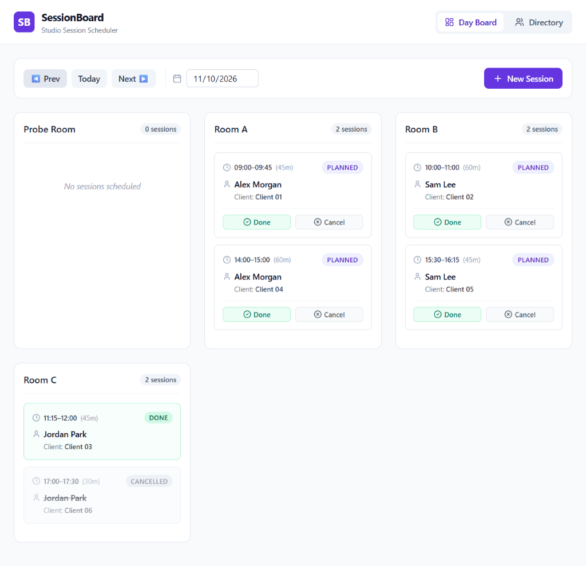
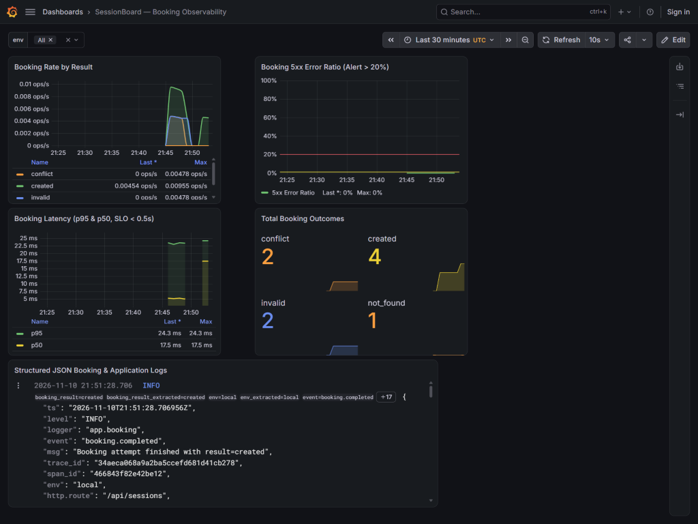
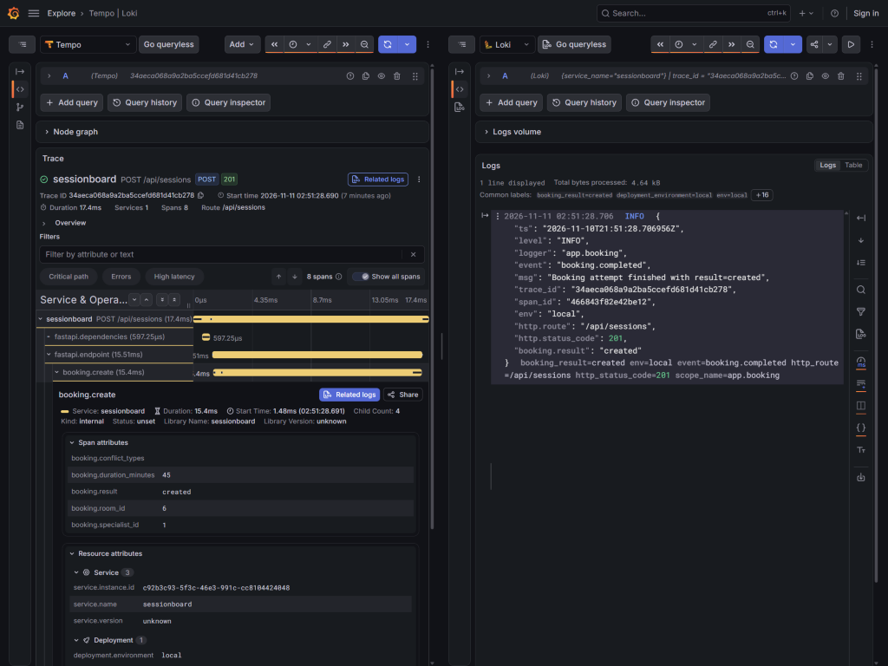
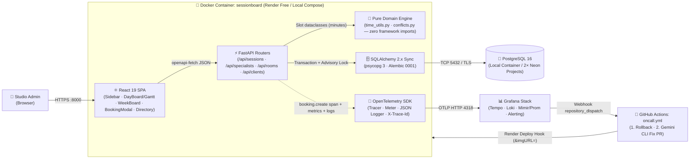
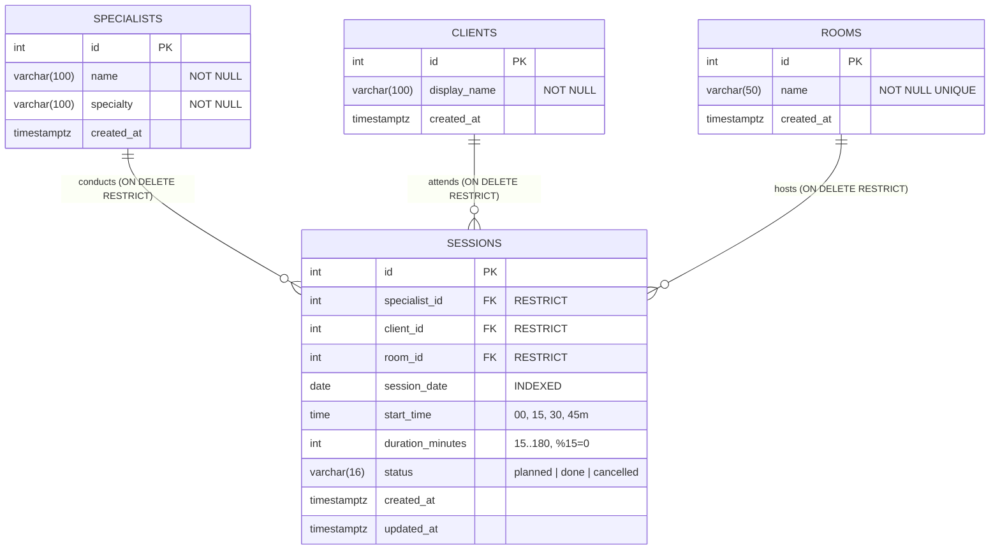
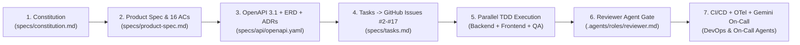

<div align="center">

# 📅 SessionBoard

**Conflict-Free Daily Session Scheduler for Small Studios**  
*Built with FastAPI, PostgreSQL 16 (`pg_advisory_xact_lock`), React 19 + TypeScript, OpenTelemetry + Grafana LGTM, and an Autonomous AI Engineering & On-Call Harness.*

[](https://github.com/brut0/sessionboard)
[](https://www.python.org/)
[](specs/api/openapi.yaml)
[](specs/data-model.md)
[](docs/architecture.md)
[](specs/nfr-observability.md)
[-16a34a?style=for-the-badge&logo=pytest&logoColor=white)](docs/testing.md)
[-0ea5e9?style=for-the-badge&logo=vitest&logoColor=white)](docs/testing.md)
[-8b5cf6?style=for-the-badge&logo=pytest&logoColor=white)](docs/ai-sdlc.md)
[](LICENSE)

[**🎓 Course Submission & Grading Guide (24/24)**](docs/SUBMISSION.md) · [**🧭 60s Live Demo**](#-live-demo--60-second-reviewer-walkthrough) · [**🔌 REST API (14 Endpoints)**](#-3-rest-api-reference) · [**🏛️ Architecture**](docs/architecture.md) · [**🧭 Archify Explorer (`HTML`)**](docs/architecture-explorer.html) · [**🧪 Testing**](docs/testing.md) · [**🚀 Deployment**](docs/deployment.md) · [**📡 Observability**](docs/observability.md) · [**🚨 On-Call Drill**](docs/oncall-demo.md) · [**🛠️ AI Tools & SDLC**](docs/ai-tools.md)

</div>

---

> [!TIP]
> **Evaluating for the DataTalksClub AI Dev Tools Zoomcamp?**  
> Read [**`docs/SUBMISSION.md`**](docs/SUBMISSION.md) for the dedicated **Peer Reviewer & Course Grading Guide (`12 / 12` Criteria — `24 / 24` Points)** with direct links to specifications, public GitHub Issues (`#1`–`#17`), CI/CD & Rollback runs, Grafana Cloud telemetry, and live Chaos Drill (`#48`/`#49`) proof.  
> Prefer exploring the architecture visually? Open [`docs/architecture-explorer.html`](docs/architecture-explorer.html) locally in your browser for 5 interactive diagrams with flow animation and dependency inspection.

<details>
<summary><strong>Course Rubric Quick-Jump Table (12 / 12 Criteria — 24 / 24 Points) -> Details in docs/SUBMISSION.md</strong></summary>

| # | Criterion | Pts | Evidence Summary | Grading Section |
|---:|---|---:|---|---|
| **1** | **Problem Description** | 2 / 2 | Studio triple-resource scheduling problem, features & expected behavior | [`SUBMISSION.md` #1](docs/SUBMISSION.md#criterion-1-problem-description-2--2-pts) |
| **2** | **Product Specification** | 2 / 2 | `specs/product-spec.md` (16 ACs) + public [GitHub Issues](https://github.com/brut0/sessionboard/issues) & agent logs | [`SUBMISSION.md` #2](docs/SUBMISSION.md#criterion-2-product-specification--public-task-tracker-2--2-pts) |
| **3** | **Agent Team Spec** | 2 / 2 | 8 roles (`.agents/roles/`), 4 skills (`.agents/skills/`), dispatch matrix | [`SUBMISSION.md` #3](docs/SUBMISSION.md#criterion-3-agent-team-specification-2--2-pts) |
| **4** | **Context Management** | 2 / 2 | [`AGENTS.md`](AGENTS.md) & [`CLAUDE.md`](CLAUDE.md) modular routing to `specs/` & `docs/` | [`SUBMISSION.md` #4](docs/SUBMISSION.md#criterion-4-context-management-2--2-pts) |
| **5** | **Application** | 2 / 2 | React 19 SPA ↔ FastAPI ↔ PostgreSQL 16 (`pg_advisory_xact_lock`) | [`SUBMISSION.md` #5](docs/SUBMISSION.md#criterion-5-application-2--2-pts) |
| **6** | **Testing** | 2 / 2 | **110 tests** (`49` backend 90%, `21` frontend 93.84%, `40` AI SDLC 78%) | [`SUBMISSION.md` #6](docs/SUBMISSION.md#criterion-6-testing-unit-integration--frontend-2--2-pts) |
| **7** | **Containerization** | 2 / 2 | Multi-stage [`Dockerfile`](Dockerfile) + single-command [`docker-compose.yml`](docker-compose.yml) | [`SUBMISSION.md` #7](docs/SUBMISSION.md#criterion-7-containerization-2--2-pts) |
| **8** | **Deployment** | 2 / 2 | Live Render `prod`, `dev` & owner-gated `ai-sdlc` backed by Neon Postgres 16 | [`SUBMISSION.md` #8](docs/SUBMISSION.md#criterion-8-deployment-2--2-pts) |
| **9** | **CI/CD** | 3 / 3 | PR CI (`5` jobs) → auto CD `dev` → manual-approved `deploy-prod.yml` → `rollback.yml` | [`SUBMISSION.md` #9](docs/SUBMISSION.md#criterion-9-cicd-3--3-pts) |
| **10** | **Observability** | 2 / 2 | OTel Tempo traces + Loki JSON logs (`trace_id`) + Mimir SLIs, zero PII | [`SUBMISSION.md` #10](docs/SUBMISSION.md#criterion-10-observability-2--2-pts) |
| **11** | **Alerting** | 1 / 1 | User-impact SLI alert `BookingErrorRatioHigh` in Grafana Cloud | [`SUBMISSION.md` #11](docs/SUBMISSION.md#criterion-11-alerting-on-user-impact-1--1-pt) |
| **12** | **On-Call Agent** | 2 / 2 | Webhook → `.github/workflows/oncall.yml` → rollback + Gemini CLI fix PR `#49` | [`SUBMISSION.md` #12](docs/SUBMISSION.md#criterion-12-on-call-responder-agent-2--2-pts) |

</details>

---

## 🌐 Live Demo & 60-Second Reviewer Walkthrough

### Live Cloud Environments

| Environment | Live UI | API Docs (Swagger / ReDoc) | Health & Deployed SHA | Notes |
|---|---|---|---|---|
| **Production (`prod`)** | https://sessionboard-prod.onrender.com | [`/docs`](https://sessionboard-prod.onrender.com/docs) · [`/redoc`](https://sessionboard-prod.onrender.com/redoc) | [`/api/health`](https://sessionboard-prod.onrender.com/api/health) · [`/api/version`](https://sessionboard-prod.onrender.com/api/version) | Promoted manually from `dev` via `deploy-prod.yml` |
| **Staging (`dev`)** | https://sessionboard-dev.onrender.com | [`/docs`](https://sessionboard-dev.onrender.com/docs) · [`/redoc`](https://sessionboard-dev.onrender.com/redoc) | [`/api/health`](https://sessionboard-dev.onrender.com/api/health) · [`/api/version`](https://sessionboard-dev.onrender.com/api/version) | Auto-deployed on `main` + Grafana Cloud OTLP + synthetic probes |
| **Companion AI SDLC** | https://essionboard-ai-sdlc.onrender.com | — *(owner-only)* | [`/api/health`](https://essionboard-ai-sdlc.onrender.com/api/health) | Decoupled feature workbench (`SDLC_REQUIRE_AUTH=true`) |

> [!NOTE]
> **Render Free Tier Cold-Start Notice (`~30–50s`):** Free-tier cloud instances automatically sleep after 15 minutes of inactivity. Your first page load or API request after idle time takes roughly **30–50 seconds** to wake the container and Neon PostgreSQL connection; every call after that responds immediately.

### 60-Second Walkthrough (Try in Browser)

1. **Inspect Daily & Weekly Views:** Open **Production** (https://sessionboard-prod.onrender.com) and switch the date picker to **`2026-11-10`** (when running locally with Docker Compose, `Today` is seeded automatically). Switch between **`Columns`** and **`Gantt Timeline`** (`By Room` / `By Specialist`), use specialist/status filters, inspect the live KPI ribbon (`Total`, `Planned`, `Completed`, `Cancelled`, `Studio Load %`), or open **`Week Overview`** in the left sidebar.
2. **Test Atomic Conflict Prevention (`409 Conflict`):** Click **`+ Book Session`** (or click any open cell in the Gantt grid), choose Date **`2026-11-10`**, Start **`09:00`**, Duration **`45 min`**, Specialist **`Alex Morgan`**, Room **`Room A`**, Client **`Client 01`**, and submit. Because Session `#1` already occupies `09:00–09:45`, the backend transaction (`pg_advisory_xact_lock`) refuses the booking with **`409 Conflict`** and lists all conflicting resources (`specialist`, `room`, `client`).
3. **Create & Cancel a Session (`AC-4.2`):** Book a free slot (e.g., `12:30` for `45 min` with `Alex Morgan`, `Room A`, `Client 07`), click the card to open the slide-over **Session Details Drawer**, and click **`Cancel`**. The session becomes `CANCELLED` and immediately frees `12:30` for a new booking.
4. **Verify Directory Protection (`BR-6`):** Open **`Directory`** in the left sidebar and try deleting `Alex Morgan` or `Room A` — deletion is blocked with `409 Conflict` (`has_planned_sessions`). Add a temporary room/client and delete it cleanly (`204 No Content`).
5. **Explore Interactive API Docs:** Visit [`/docs`](https://sessionboard-prod.onrender.com/docs) to try endpoints directly against the OpenAPI 3.1 schema.

---

## 🧩 1. Problem Description, Features & Visual Walkthrough

### The Problem
Small studios (tutoring centers, music schools, coaching/therapy practices) with **2–5 rooms** and a rotating roster of specialists often coordinate daily schedules across spreadsheets or chat threads. Because **every session simultaneously locks three independent resources** — the **specialist**, the **room**, and the **client** — manual scheduling frequently causes double bookings across variable 15–180 minute slots and cancelled appointments.

### Core Capabilities (`F1`–`F4` + Weekly & Timeline Views)

1. **Studio Directory (`F1`):** Create, search/list, and delete **Specialists** (`name`, `specialty`), **Clients** (`display_name`), and **Rooms** (`name`, unique constraint). Deletion of any entity referenced by sessions is rejected (`409 Conflict`, `{"detail": "has_planned_sessions"}`).
2. **Conflict-Free Session Booking (`F2`):** Enforces 15-minute aligned slots (`08:00`–`19:45`), 15–180 minute durations (multiples of 15), and strict studio hours (`08:00`–`20:00`). All bookings execute inside a PostgreSQL transaction serialized per date via **`pg_advisory_xact_lock`**, returning structured resource conflict diagnostics (`[{"type": "specialist"|"room"|"client", "session_id": ...}]`). Touching intervals (e.g., `10:00–11:00` followed by `11:00–11:45`) are permitted cleanly.
3. **Daily Schedule Board (`F3`):** Persistent **Left Sidebar Navigation**, dual view modes (**`Columns`** grouped by room & **`Gantt Timeline`** `08:00–20:00` grouped `By Room` or `By Specialist` with click-to-prefill empty cells), live KPI ribbon, specialist/status filters, slide-over **Session Details Drawer** (with `Book Follow-up Session` prefill), and print-ready CSS.
4. **7-Day Week Overview:** Monday–Sunday weekly matrix fetching all 7 days concurrently with daily totals, completion/cancellation counts, and 1-click drill-down into any day's schedule.
5. **Session Lifecycle (`F4`):** Transitions `planned -> done | cancelled` (`PATCH /api/sessions/{id}`). Cancelling immediately releases the specialist, room, and client (`AC-4.2`); completed (`done`) sessions remain historical overlap guards.

### Screenshots

| Live Studio Day Board (`sessionboard-dev` on Render) | Grafana SLIs & Tempo/Loki Trace Correlation |
|---|---|
|  |  |

<details>
<summary>OpenTelemetry Distributed Trace -> Correlated Loki JSON Logs (`docs/images/grafana-tempo-loki-trace.png`)</summary>



</details>

---

## 🏛️ 2. System Architecture & Database Schema

> **Deep Dive:** See [`docs/architecture.md`](docs/architecture.md), [`specs/data-model.md`](specs/data-model.md), Architecture Decision Records [`docs/adr/0001`–`0003`](docs/adr/0001-stack.md), or open [`docs/architecture-explorer.html`](docs/architecture-explorer.html).

### Runtime & Cloud Topology



### Physical PostgreSQL 16 Schema



---

## 🔌 3. REST API Reference

Source-of-truth schema: [`specs/api/openapi.yaml`](specs/api/openapi.yaml) (**14 operations**, parity enforced by [`test_openapi_contract.py`](backend/tests/integration/test_openapi_contract.py); typed TypeScript client generated via `openapi-typescript`). Interactive docs are served at **`/docs`** (Swagger UI) and **`/redoc`**.

| Method | Endpoint | Status Codes | Summary & Domain Invariants |
|---|---|---|---|
| `GET` | `/api/health` | `200`, `503` | Application + PostgreSQL `SELECT 1` connectivity probe |
| `GET` | `/api/version` | `200` | Deployed commit SHA (`APP_GIT_SHA`) and environment (`local` / `dev` / `prod`) |
| `GET` | `/api/specialists` | `200` | List all specialists ordered alphabetically by `name` |
| `POST` | `/api/specialists` | `201`, `422` | Create a new specialist (`name`, `specialty`) |
| `DELETE` | `/api/specialists/{specialist_id}` | `204`, `404`, `409`, `422` | Delete specialist (`409` `has_planned_sessions` if referenced) |
| `GET` | `/api/clients` | `200` | List all clients ordered alphabetically by `display_name` |
| `POST` | `/api/clients` | `201`, `422` | Create a new client (`display_name`) |
| `DELETE` | `/api/clients/{client_id}` | `204`, `404`, `409`, `422` | Delete client (`409` `has_planned_sessions` if referenced) |
| `GET` | `/api/rooms` | `200` | List all rooms ordered alphabetically by `name` |
| `POST` | `/api/rooms` | `201`, `409`, `422` | Create a room with unique name (`409` `duplicate_room_name` on clash) |
| `DELETE` | `/api/rooms/{room_id}` | `204`, `404`, `409`, `422` | Delete room (`409` `has_planned_sessions` if referenced) |
| `GET` | `/api/sessions` | `200`, `422` | Query all sessions for `?date=YYYY-MM-DD`, ordered by `room_id`, `start_time` |
| `POST` | `/api/sessions` | `201`, `404`, `409`, `422` | Atomically book a session inside `pg_advisory_xact_lock`; rejects overlaps with `409` |
| `PATCH` | `/api/sessions/{session_id}` | `200`, `404`, `409`, `422` | Transition `planned` -> `done` \| `cancelled` (rejects already finalized sessions) |

<details>
<summary>Example: Atomic Double-Booking Refusal Response (`HTTP 409 Conflict`)</summary>

```json
{
  "detail": "conflict",
  "conflicts": [
    { "type": "specialist", "session_id": 1 },
    { "type": "room", "session_id": 1 }
  ]
}
```

</details>

---

## ⚡ 4. Quick Start, Docker Compose & Cross-Platform Commands

### Single-Command Local Stack (`docker compose up --build`)

No `.env` creation is required — defaults work out of the box:

```bash
git clone https://github.com/brut0/sessionboard.git
cd sessionboard
docker compose up --build
```

| Service | Local URL | Purpose |
|---|---|---|
| **SessionBoard App & API** | http://localhost:8000 | React 19 SPA + FastAPI API (auto-migrated & seeded for `Today`) |
| **Interactive Swagger / ReDoc** | http://localhost:8000/docs | OpenAPI 3.1 try-it-out UI ([ReDoc](http://localhost:8000/redoc)) |
| **Health & Version Probes** | http://localhost:8000/api/health | JSON DB check + build SHA (`/api/version`) |
| **Grafana LGTM Stack** | http://localhost:3000 | Grafana UI (`admin` / `admin`) + Tempo + Loki + Prometheus |
| **AI SDLC Workbench *(opt.)*** | http://127.0.0.1:8090 | Add `--profile sdlc` to run the companion pipeline workbench alongside |

Stop containers (`docker compose down`; add `-v` only if you want a clean database reset).

### Command Reference (`Makefile` & Native Windows PowerShell)

On macOS/Linux (or Windows with `make`), use `Makefile` shortcuts; on Windows without `make`, run the equivalent PowerShell commands (ensure **Docker Desktop** is running for integration tests):

| Action | `make` Target | Native Windows PowerShell Equivalent |
|---|---|---|
| **Start Full Stack** | `make up` | `docker compose up --build -d` |
| **Stop Full Stack** | `make down` | `docker compose down` |
| **Run Core Test Suites** | `make test` | `cd backend; uv run pytest; cd ..\frontend; npm test; cd ..` |
| **Backend Tests Only** | `make test-backend` | `cd backend; uv run pytest -v; cd ..` |
| **Frontend Tests Only** | `make test-frontend` | `cd frontend; npm test; cd ..` |
| **AI SDLC Tests** | `make test-ai-sdlc` | `cd tools/ai-sdlc; uv run pytest -v; cd ..\..` |
| **Lint & Typecheck** | `make lint` | `cd backend; uv run ruff check .; uv run ruff format --check .; cd ..\frontend; npm run typecheck; cd ..` |
| **Regenerate API Types** | `make openapi` | `cd frontend; npm run gen:api; cd ..` |
| **Repo Hygiene Guard** | `make hygiene` | `uv run --project backend python scripts/check_repo_hygiene.py` |
| **AI SDLC Web UI (:8090)** | `make ai-sdlc` | `cd tools/ai-sdlc; uv run uvicorn sdlc_app.main:app --host 127.0.0.1 --port 8090 --reload; cd ..\..` |

### Local Observability & Alert Verification (`http://localhost:3000`)

1. With `docker compose up --build -d` running, trigger a synthetic booking lifecycle + verify trace headers:
   ```powershell
   uv run --project backend python scripts/synthetic_probe.py --base-url http://localhost:8000 --mode once
   curl.exe -i -X POST http://localhost:8000/api/sessions -H "Content-Type: application/json" -d "{\"specialist_id\":1,\"client_id\":7,\"room_id\":2,\"session_date\":\"2026-11-18\",\"start_time\":\"13:00\",\"duration_minutes\":30}"
   ```
2. Copy the `X-Trace-Id` response header -> open Grafana **Explore -> Tempo** (`http://localhost:3000/explore`), search by Trace ID to inspect the `booking.create` span + SQL queries, and click **Related logs** to inspect matching Loki JSON logs (`zero PII`).
3. Import [`ops/grafana/dashboard.json`](ops/grafana/dashboard.json) (SLI panels + 20% 5xx threshold) and inspect alert expression `$B >= 3 && ($A / $B) > 0.2` from [`ops/grafana/alert-rule.json`](ops/grafana/alert-rule.json).

---

## 🧪 5. Testing, CI/CD, Observability & On-Call Operations

### Automated Test Coverage (**110 Tests Passing**, Published in GitHub Actions `$GITHUB_STEP_SUMMARY`)

| Suite | Tooling | Tests | Coverage | Verified Scope |
|---|---|---:|---:|---|
| **Backend (`backend/app`)** | `pytest` + `pytest-cov` + `testcontainers` Postgres 16 | **49 passed** | **90%** | `domain/` 100%, `models.py` & `schemas.py` 100%, routers 99–100%, OpenAPI parity & zero-PII canary test |
| **Frontend (`frontend/src`)** | `vitest` + `@vitest/coverage-v8` + RTL + MSW 2 | **21 passed** | **93.84%** | `WeekBoard.tsx` 97.23%, `BookingModal.tsx` 96.38%, `DayBoard.tsx` 95.62%, `App.tsx` 94.21% |
| **Companion AI SDLC (`tools/ai-sdlc`)** | `pytest` + `pytest-cov` | **40 passed** | **78%** | Owner auth fail-closed (`503`/`401`/`429`/`403`), hygiene/path guards, LLM adapter secret redaction, git runners |

### CI/CD, Observability & Self-Healing On-Call Pipeline

- **CI/CD Pipelines ([`.github/workflows/`](.github/workflows/)):**
  - `ci.yml` — 5 branch-protected PR checks (`Repository Hygiene`, `Backend Lint & Tests`, `Frontend Lint & Tests`, `AI SDLC Workbench Tests`, `Docker Build`).
  - `cd-dev.yml` — Automatically builds immutable GHCR images (`<sha>`), rolls out to `sessionboard-dev`, polls `/api/version`, and runs `synthetic_probe.py`.
  - `deploy-prod.yml` & `rollback.yml` — Owner-approved production promotion (`production` GitHub environment reviewer gate) and deterministic SHA rollback on `dev` or `prod`.
- **Zero-PII Observability ([`docs/observability.md`](docs/observability.md)):** Every request correlates OpenTelemetry traces (`booking.create`), low-cardinality Prometheus metrics (`sessionboard_bookings_total`), and stdout/Loki JSON logs (`trace_id`) with zero names, request bodies, or credentials (`test_telemetry_no_pii.py`).
- **Alerting & Autonomous On-Call ([`docs/oncall-demo.md`](docs/oncall-demo.md)):** Grafana Cloud alert rule `BookingErrorRatioHigh` triggers `.github/workflows/oncall.yml`, which opens an incident issue, immediately runs `rollback.yml` on `dev`, queries zero-PII Loki logs, invokes headless **Gemini CLI**, opens an auto-tested fix PR (`PR #49` in the live Chaos Drill), and verifies alert recovery.

---

## 🤖 6. Multi-Agent Team, Dual AI SDLC & Repository Map

### Spec-Driven Development & 8-Role Agent Team

SessionBoard follows Spec-Driven Development (SDD) executed by **8 specialized AI agent roles** tracked publicly in [GitHub Issues](https://github.com/brut0/sessionboard/issues) and gated at every phase boundary ([`docs/agents/team.md`](docs/agents/team.md), [`docs/ai-tools.md`](docs/ai-tools.md)):



### Dual AI SDLC Pipeline (Reusable for Ongoing Features)

Beyond core scheduling, the repository ships a **Dual AI SDLC Pipeline** ([`docs/ai-sdlc.md`](docs/ai-sdlc.md)) preserving constitution/domain/hygiene invariants on every future change:
- **Option A — Chat-Native Pipeline:** Trigger `.agents/skills/feature-sdlc/SKILL.md` inside Antigravity/Claude/Codex for human-gated `Spec -> Architecture -> Parallel TDD -> Reviewer -> PR`.
- **Option B — Companion Web Workbench (`tools/ai-sdlc/`, port `:8090`):** Independent FastAPI workbench (`make ai-sdlc`, `--profile sdlc`, or owner-gated Render deployment) supporting Google Gemini & OpenAI-compatible APIs, surgical search/replace edits, HTTP `409` spec-approval lock, fail-closed auth (`503`/`401`/`429`/`403`), 1-click verification gates, and automated PR creation.

### Repository Structure

```text
sessionboard/
├── AGENTS.md                        # Context entrypoint for AI coding agents
├── CLAUDE.md                        # Claude Code companion instructions delegating to AGENTS.md
├── README.md                        # Classic product & engineering guide (this file)
├── Dockerfile                       # Multi-stage build (Node 22 SPA -> Python 3.12 non-root runtime)
├── docker-compose.yml               # Local stack: Postgres 16 + SessionBoard + Grafana OTel-LGTM (+ --profile sdlc)
├── Makefile                         # Unified dev, lint, test, OpenAPI, seed & AI SDLC targets
├── LICENSE                          # MIT License
├── backend/
│   ├── alembic/                     # Forward-only PostgreSQL migrations (0001_initial_schema.py)
│   ├── app/
│   │   ├── domain/                  # Pure scheduling domain (zero SQLAlchemy/FastAPI imports)
│   │   ├── routers/                 # /api/specialists, /api/clients, /api/rooms, /api/sessions
│   │   └── {config,db,logging_config,models,schemas,seed,telemetry,main}.py
│   └── tests/                       # Unit + testcontainers PostgreSQL integration + contract + zero-PII (49 tests)
├── frontend/
│   └── src/
│       ├── api/                     # Generated schema.d.ts (openapi-typescript) + openapi-fetch client
│       ├── utils/                   # Studio time math (08:00-20:00), UTC week helpers & palette theme
│       └── components/              # DayBoard (Columns/Gantt/Drawer), WeekBoard, BookingModal, DirectoryPage (21 tests)
├── ops/
│   └── grafana/                     # dashboard.json, alert-rule.json, contact-point-payload.tmpl
├── specs/
│   ├── constitution.md              # Stack locks, architectural invariants & global DoD
│   ├── product-spec.md              # User stories US-1..US-4, BR-1..BR-9 & 16 ACs
│   ├── data-model.md                # PostgreSQL 16 schema, indexes & advisory lock spec
│   ├── nfr-observability.md         # SLIs/SLOs, OTel signals, zero-PII policy & alerting
│   ├── tasks.md                     # Tasks T01..T16 mapped to Issues #2..#17 and ACs
│   └── api/openapi.yaml             # Source-of-truth OpenAPI 3.1 contract (14 operations)
├── docs/
│   ├── SUBMISSION.md                # Dedicated course submission & 12-criterion peer reviewer guide (24/24)
│   ├── architecture.md              # Detailed system architecture, sequences & state machine
│   ├── architecture-explorer.html   # Standalone interactive Archify-style diagram explorer
│   ├── observability.md             # OTel trace -> log -> metric correlation guide & Grafana screenshots
│   ├── oncall-demo.md               # Phase 9 Chaos Drill & autonomous on-call remediation report
│   ├── runbooks/                    # Operational incident runbooks (booking-errors.md)
│   ├── images/                      # Live UI (sessionboard-dayboard.png) & Grafana OTel screenshots
│   ├── testing.md                   # Multi-layer test strategy & AC traceability matrix (110 tests)
│   ├── deployment.md                # Environments, expand-contract migrations, CD & rollback runbook
│   ├── ai-tools.md                  # Antigravity IDE harness, subagents, skills, MCP & Gemini on-call CLI
│   ├── ai-sdlc.md                   # Guide for Chat-native & Companion Web AI SDLC pipelines
│   ├── process.md                   # SDD/TDD workflow, branching, trailers & PR gates
│   ├── agents/team.md               # Multi-agent team responsibilities & sequence
│   ├── adr/0001..0003-*.md          # Architecture Decision Records
│   └── plan/{MASTER_PLAN,EXECUTION_GUIDE,PRE_PHASE_8_HUMAN_CHECKLIST}.md
├── tools/
│   └── ai-sdlc/                     # Decoupled Owner-Gated Companion AI SDLC Workbench (Dockerfile, :8090, 40 tests)
├── .agents/
│   ├── roles/*.md                   # System prompts for all 8 agent roles
│   ├── skills/*/SKILL.md            # issue-workflow, phase-gate, release-and-rollback, feature-sdlc
│   └── references/verification-commands.md # Shared verification commands & Windows PowerShell notes
├── .github/
│   ├── ISSUE_TEMPLATE/task.yml      # Spec-backed task template with AC checkboxes
│   ├── pull_request_template.md     # PR checklist template
│   └── workflows/                   # ci.yml, cd-dev.yml, deploy-prod.yml, rollback.yml, synthetic-probe.yml, oncall.yml
└── scripts/
    ├── check_repo_hygiene.py        # Automated English-only & clean-room guard
    ├── synthetic_probe.py           # Zero-dependency synthetic booking smoke/burst probe
    └── install-hooks.{sh,ps1}       # Pre-commit hook installers
```
