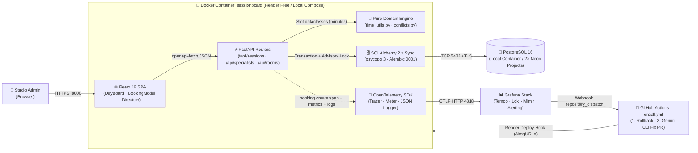
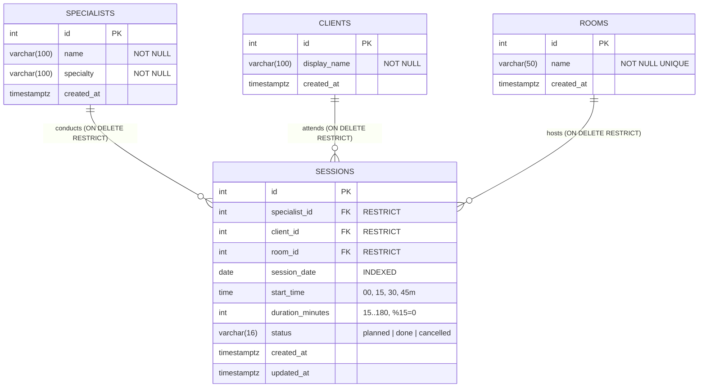
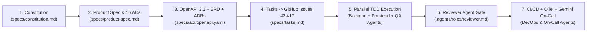
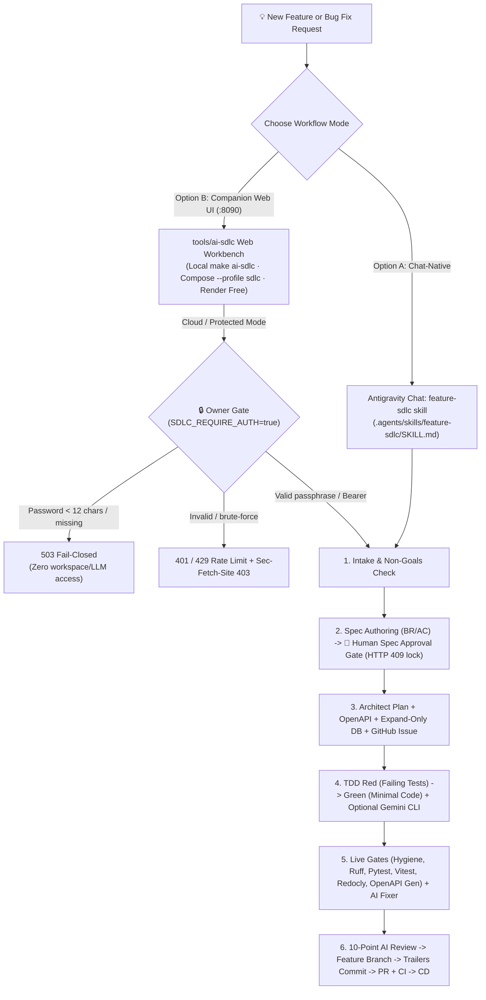

<div align="center">

# 📅 SessionBoard

**Conflict-Free Daily Session Scheduler for Small Studios**  
*Built with Spec-Driven Development (SDD), a Multi-Agent Engineering Harness, OpenTelemetry Observability, and a Self-Healing On-Call Responder Agent.*

[](https://github.com/brut0/sessionboard)
[](https://www.python.org/)
[](specs/api/openapi.yaml)
[](specs/data-model.md)
[](docs/architecture.md)
[](specs/nfr-observability.md)
[](LICENSE)

[**📖 Product Spec**](specs/product-spec.md) · [**🔌 OpenAPI 3.1 Contract**](specs/api/openapi.yaml) · [**🏛️ Architecture & ADRs**](docs/architecture.md) · [**🧭 Interactive Archify Explorer (`HTML`)**](docs/architecture-explorer.html) · [**🧪 Testing**](docs/testing.md) · [**🚀 Deployment**](docs/deployment.md) · [**🛠️ Dual AI SDLC**](docs/ai-sdlc.md) · [**🤖 Agent Team**](docs/agents/team.md) · [**📋 Public Issue Tracker**](https://github.com/brut0/sessionboard/issues)

</div>

---

## 🎯 Executive Summary (AI Dev Tools Zoomcamp Final Project)

**SessionBoard** is an end-to-end production-ready web application built for the **[DataTalksClub AI Dev Tools Zoomcamp](https://github.com/DataTalksClub/ai-dev-tools-zoomcamp/tree/main/project)**. It solves a concrete operational problem for small studios while demonstrating a rigorous, reproducible AI-native software engineering workflow from specification to automated incident response.

> 💡 **Interactive Architecture Explorer (Archify Style):** Open [`docs/architecture-explorer.html`](docs/architecture-explorer.html) locally in your browser to explore 5 interactive diagram views (*System Architecture, Atomic Booking Sequence, Physical ERD, CI/CD & Rollback, and Multi-Agent SDD Harness*) with clickable node inspection, upstream/downstream dependency highlighting, dark/light theme toggle, and animated flow playback.

---

## ✅ Course Evaluation Rubric Checklist (12 Criteria — 24 / 24 Points)

This table guides peer reviewers directly to the evidence for every grading criterion:

| # | Criterion | Max Pts | Status | Direct Evidence in This Repository |
|---:|---|---:|:---:|---|
| **1** | **Problem Description** | **2 pts** | ✅ | [§1 Problem & Expected Behavior](#-1-problem-description--expected-behavior) below + [`specs/product-spec.md` §1](specs/product-spec.md#1-problem-statement--personas) |
| **2** | **Product Specification & Public Task Tracker** | **2 pts** | ✅ | [`specs/constitution.md`](specs/constitution.md), [`specs/product-spec.md`](specs/product-spec.md) (16 Given/When/Then ACs), [`specs/tasks.md`](specs/tasks.md), and public [GitHub Issues `#1`–`#17`](https://github.com/brut0/sessionboard/issues) with agent start/finish logs |
| **3** | **Agent Team Specification** | **2 pts** | ✅ | [`docs/agents/team.md`](docs/agents/team.md) + 8 role prompts in [`.agents/roles/`](.agents/roles/) + 4 workflow skills in [`.agents/skills/`](.agents/skills/) + dispatch matrix in [`docs/plan/EXECUTION_GUIDE.md` §3.5](docs/plan/EXECUTION_GUIDE.md) |
| **4** | **Context Management** | **2 pts** | ✅ | [`AGENTS.md`](AGENTS.md) entry point linking modular docs: [`docs/process.md`](docs/process.md), [`docs/agents/team.md`](docs/agents/team.md), [`docs/architecture.md`](docs/architecture.md), [`docs/testing.md`](docs/testing.md), [`docs/deployment.md`](docs/deployment.md), [`docs/ai-sdlc.md`](docs/ai-sdlc.md), [`docs/adr/`](docs/adr/), [`specs/`](specs/) |
| **5** | **Application (Full-Stack + DB)** | **2 pts** | ✅ | React 19 SPA (`DayBoard`, `BookingModal`, `DirectoryPage`) ↔ FastAPI REST API ↔ PostgreSQL 16 with `pg_advisory_xact_lock` (Issues [`#2`–`#11`](https://github.com/brut0/sessionboard/issues), PRs `#18`–`#27`) |
| **6** | **Testing (Unit + Integration + Frontend)** | **2 pts** | ✅ | **54 core app tests passing** (39 backend unit + `testcontainers` PostgreSQL 16 integration + OpenAPI contract tests, 15 frontend Vitest/RTL/MSW tests) + **38 AI SDLC workbench tests**; see [`docs/testing.md`](docs/testing.md) (Issues [`#4`, `#7`, `#12`](https://github.com/brut0/sessionboard/issues)) |
| **7** | **Containerization** | **2 pts** | ✅ | Multi-stage [`Dockerfile`](Dockerfile) + [`docker-compose.yml`](docker-compose.yml) (`db` + `app` + `otel-lgtm`) + companion [`tools/ai-sdlc/Dockerfile`](tools/ai-sdlc/Dockerfile) (`--profile sdlc`, Issue [`#2`](https://github.com/bruti/sessionboard/issues/2), PR `#18`) |
| **8** | **Deployment** | **2 pts** | 🚧 *Phase 7 (Human Setup)* | Deployment workflows & GHCR image built (PR `#31`); awaiting human Render Free + Neon PostgreSQL 16 setup and live verification per [`docs/plan/PRE_PHASE_8_HUMAN_CHECKLIST.md`](docs/plan/PRE_PHASE_8_HUMAN_CHECKLIST.md) (Issue [`#14`](https://github.com/brut0/sessionboard/issues/14)) |
| **9** | **CI/CD (PR CI → Auto Dev → Manual Prod + Rollback)** | **3 pts** | ✅ CI / 🚧 CD | `ci.yml` live & enforced by branch protection (`Repository Hygiene`, `Backend Lint & Tests`, `Frontend Lint & Tests`, `Docker Build`); `cd-dev.yml`, `deploy-prod.yml`, `rollback.yml`, and `synthetic-probe.yml` merged in PR `#31` ([`docs/deployment.md`](docs/deployment.md), Issues [`#13`, `#14`](https://github.com/brut0/sessionboard/issues/13)) |
| **10** | **Observability (Traces + Metrics + Logs, Zero PII)** | **2 pts** | 🔜 *Phase 8* | OpenTelemetry instrumentation of `POST /api/sessions` (`booking.create` span, `sessionboard_bookings_total`, JSON logs with shared `trace_id`, `test_telemetry_no_pii.py`) in [`specs/nfr-observability.md`](specs/nfr-observability.md) (Issue [`#15`](https://github.com/brut0/sessionboard/issues/15)) |
| **11** | **Alerting on User Impact** | **1 pt** | 🔜 *Phase 9* | Grafana alert `BookingErrorRatioHigh` (`error / total > 20%` over 5m when `B >= 3`) on real booking failures, not CPU graphs (Issue [`#16`](https://github.com/brut0/sessionboard/issues/16)) |
| **12** | **On-Call Responder Agent** | **2 pts** | 🔜 *Phase 9* | `oncall.yml` woken via Grafana webhook `repository_dispatch`: opens `[incident]` issue, triggers deterministic rollback, and runs headless **Gemini CLI** to open a regression-tested fix PR (Issue [`#16`](https://github.com/brut0/sessionboard/issues/16)) |

---

## 🧩 1. Problem Description & Expected Behavior

### The Problem
Small studios (tutoring centers, music or coaching studios, speech/therapy practices) with **2–5 rooms** and a handful of specialists often manage their daily schedule in shared spreadsheets or chat threads. Because **three independent resources** must be free simultaneously for every session — the **specialist**, the **room**, and the **client** — administrators frequently create accidental double bookings. Detecting overlaps manually across varying session durations (15 to 180 minutes) and accounting for cancelled sessions is error-prone.

### What SessionBoard Does
**SessionBoard** is a focused daily scheduling web application for a **Studio Administrator**:

1. **Studio Directory (`F1` — Directory tab):**
   - List, create, and delete **Specialists** (`name`, `specialty`), **Clients** (`display_name`), and **Rooms** (`name`, unique).
   - Referential protection (`BR-6`): deleting a specialist, client, or room referenced by sessions is blocked with `409 Conflict` (`{"detail": "has_planned_sessions"}`).
2. **Conflict-Free Session Booking (`F2` — Booking Modal):**
   - Book a session on a chosen date with a 15-minute aligned start time (`08:00`–`19:45`) and duration (`15`–`180` minutes, step `15`) within studio working hours (`08:00`–`20:00`, `BR-1`, `BR-2`).
   - **Atomic Overlap Check (`BR-3`, `BR-4`, `BR-8`):** Inside a PostgreSQL transaction protected by a date-scoped advisory lock (`pg_advisory_xact_lock`), the pure domain conflict engine checks all non-cancelled sessions on that date.
   - Touching intervals (e.g. `10:00–11:00` followed by `11:00–11:45`) are **allowed**.
   - If any resource overlaps, the booking is refused with `409 Conflict` and an exact list of conflicts (`[{"type": "specialist"|"room"|"client", "session_id": 12}]`), rendered clearly in the modal (`"Room is busy (session #12)"`).
3. **Daily Schedule Board (`F3` — Day Board tab):**
   - Displays one column per room for the selected date, with session cards ordered by start time (`HH:MM–HH:MM`, specialist name, client display name, status badge) and quick date navigation (`◀ Prev`, `Today`, `Next ▶`).
4. **Session Lifecycle Transitions (`F4` — Day Board actions):**
   - Sessions start as `planned` and can transition to `done` or `cancelled` (`PATCH /api/sessions/{id}`).
   - Marking a session `cancelled` immediately frees its specialist, room, and client for new bookings (`AC-4.2`), while `done` sessions remain in history and continue to guard against accidental overlaps.

---

## 🏛️ 2. System Architecture & Visual Diagrams

> 🔗 **Deep Dive:** See [`docs/architecture.md`](docs/architecture.md), [`specs/data-model.md`](specs/data-model.md), and the interactive viewer [`docs/architecture-explorer.html`](docs/architecture-explorer.html).

### 2.1 Runtime & Cloud Topology



### 2.2 Database Entity-Relationship Diagram (PostgreSQL 16)



---

## 🤖 3. Spec-Driven Development (SDD) & Multi-Agent Team

SessionBoard is built by an orchestrated team of **8 specialized AI agent roles** coordinated via GitHub Issues (`#1`–`#17`) and verified at every phase boundary by deterministic gates ([`phase-gate` skill](.agents/skills/phase-gate/SKILL.md)).



| Agent Role | System Prompt | Primary Ownership |
|---|---|---|
| **Spec Agent** | [`.agents/roles/spec.md`](.agents/roles/spec.md) | `specs/constitution.md`, `specs/product-spec.md`, `specs/nfr-observability.md`, `README.md` |
| **Architect Agent** | [`.agents/roles/architect.md`](.agents/roles/architect.md) | `specs/data-model.md`, `specs/api/openapi.yaml`, `docs/architecture.md`, `docs/adr/`, `specs/tasks.md` |
| **Backend Agent** | [`.agents/roles/backend.md`](.agents/roles/backend.md) | `backend/app/` (pure domain, SQLAlchemy models, Alembic migrations, FastAPI routes, OTel) |
| **Frontend Agent** | [`.agents/roles/frontend.md`](.agents/roles/frontend.md) | `frontend/src/` (`DayBoard`, `BookingModal`, `DirectoryPage`, generated OpenAPI client) |
| **QA Agent** | [`.agents/roles/qa.md`](.agents/roles/qa.md) | Independent AC integration tests (`test_ac_*`), OpenAPI contract test, Vitest/RTL tests |
| **Reviewer Agent** | [`.agents/roles/reviewer.md`](.agents/roles/reviewer.md) | 10-point PR gate against specs, constitution, error contract, and zero-PII hygiene |
| **DevOps Agent** | [`.agents/roles/devops.md`](.agents/roles/devops.md) | `Dockerfile`, `docker-compose.yml`, `Makefile`, GitHub Actions CI/CD, Grafana dashboards/alerts |
| **On-Call Agent** | [`.agents/roles/oncall.md`](.agents/roles/oncall.md) | Headless Gemini CLI responder inside `.github/workflows/oncall.yml` |

---

## 🛠️ Dual AI SDLC Pipeline & Owner-Gated Deployment

SessionBoard includes a **complete, reusable Dual AI SDLC Pipeline** ([`docs/ai-sdlc.md`](docs/ai-sdlc.md)) for designing, testing, verifying, and shipping post-MVP features and bug fixes while preserving every architectural invariant (`AGENTS.md`, `specs/constitution.md`, domain purity, OpenAPI parity, zero-PII logs, English-only hygiene).



### Option A — Chat-Native Multi-Agent Pipeline (Antigravity IDE / Chat)

Best when working directly inside Antigravity with full local codebase & subagent orchestration ([`.agents/skills/feature-sdlc/SKILL.md`](.agents/skills/feature-sdlc/SKILL.md)):

1. **Trigger in Chat:** Ask:
   ```text
   Use the feature-sdlc skill to implement: <describe your feature or bug fix>.
   Stop after Stage 1 (Spec) for my "spec approved" before changing OpenAPI or code.
   ```
2. **Enforced Stages:**
   - **Stage 0 (Intake & Constitution Guard):** Validates the request against [`specs/product-spec.md`](specs/product-spec.md) §7 Non-Goals (`No Auth in core scheduler`, `No Pricing`, etc.), zero-PII telemetry rules, and pure domain boundaries (`backend/app/domain/`).
   - **Stage 1 (Spec First + Human Pause):** Dispatches `spec-agent` to draft Business Rules (`BR-*`) and `Given/When/Then` ACs in `specs/product-spec.md`, then pauses until you explicitly reply `"spec approved"`.
   - **Stage 2 (Architecture + GitHub Issue):** Dispatches `architect-agent` to update [`specs/api/openapi.yaml`](specs/api/openapi.yaml) (verified via Redocly lint), design expand-only Alembic migrations, update [`specs/tasks.md`](specs/tasks.md), and open a labeled GitHub Issue via `issue-workflow`.
   - **Stage 3 (Parallel TDD Dispatch):** Launches independent `qa-agent` (`test_ac_*`), `backend-agent`, and `frontend-agent` (`npm run gen:api` + Vitest/RTL/MSW) in test-first order.
   - **Stage 4–6 (Verification, Review, Docs & Ship):** Runs `check_repo_hygiene.py`, `ruff`, `pytest`, `typecheck`, `vitest`, 10-point `reviewer-agent` audit, `README.md` sync, feature PR creation, CI watch, and auto-dev rollout.

### Option B — Companion AI SDLC Web Workbench (`tools/ai-sdlc/` — Port `8090`)

Best when you want an independent browser control plane running side-by-side next to SessionBoard (`:8090` alongside `:8000`) powered directly by **Google Gemini API** (`GEMINI_API_KEY`) or any **OpenAI-compatible endpoint** (`OPENAI_API_KEY` + `OPENAI_BASE_URL`, e.g., OpenAI, OpenRouter, local Ollama), plus optional headless **Gemini CLI**:

- **Interactive Stage Controls:** Create tracked pipeline runs stored in git-ignored `.local/ai-sdlc/runs/`, execute `intake -> spec -> architect -> tdd_tests -> implement -> fix_failure -> review`, inspect unified diffs before writing a single byte, and selectively apply file patches.
- **Spec-First Lock (`HTTP 409`):** `architect`, `tdd_tests`, and `implement` stages are rejected by the server until you click **Approve Spec**.
- **Pre-Flight Safety Guards (`HTTP 422`):** Every file patch, branch name, commit message, issue, and PR body is checked against path containment rules (never touching `.git/`, `.local/`, `.env*`, `node_modules/`, `frontend/dist/`, or `backend/app/static/`) and English-only / forbidden-terms hygiene (`scripts/check_repo_hygiene.py`).
- **One-Click Verification & AI Fixer:** Runs `hygiene`, `backend_lint`, `backend_tests`, `frontend_checks`, `openapi_lint`, `openapi_sync`, and `ai_sdlc_tests`; failed logs can be routed directly to Stage 5 (`fix_failure`) to generate targeted patch candidates.
- **Git & PR Automation:** Creates `feat/*` branches (blocks direct commits to `main`), commits with `Agent:` & `Refs: #N` trailers (`commit.gpgsign=false` headless safe), and opens GitHub PRs via `gh`.

### Deployment Modes & Owner-Only Security Model

`tools/ai-sdlc` stays **100% decoupled** from SessionBoard's core container (excluded via `.dockerignore`) and runs in three supported topologies:

| Mode | Command / Service | Auth Default | Intended Use |
|---|---|---|---|
| **Local Python** | `make ai-sdlc` (`127.0.0.1:8090`) | Open locally (`SDLC_REQUIRE_AUTH=false` when `APP_ENV=local` and no password set) | Fast local feature iteration without container rebuilds |
| **Full-Suite Docker Compose** | `docker compose --profile sdlc up --build` (`127.0.0.1:8090` alongside `:8000` & `:3000`) | Local open by default; toggle `SDLC_REQUIRE_AUTH=true` + `SDLC_OWNER_PASSWORD=...` | Complete all-in-one local stack (`db` + `app` + `otel-lgtm` + `ai-sdlc`) |
| **Cloud Companion (Render Free)** | `sessionboard-ai-sdlc` (`ghcr.io/brut0/sessionboard-ai-sdlc:<sha>`) | **Strictly fail-closed** (`SDLC_REQUIRE_AUTH=true`, `APP_ENV=prod`) | Remote owner access over HTTPS without leaking repo control |

> 🔐 **How Owner-Only Protection Is Enforced (Fail-Closed by Default):**
> 1. **Fail-Closed Startup Guard (`503`):** Whenever `SDLC_REQUIRE_AUTH=true`, `APP_ENV != local`, `RENDER=true`, or `SDLC_OWNER_PASSWORD` is non-empty, if `SDLC_OWNER_PASSWORD` is missing or shorter than 12 characters, all workbench `/api/*` and `/docs` routes return `503 Service Unavailable`.
> 2. **Signed Cookie & Bearer Auth (`401`):** Every workspace, config, LLM stage, patch, gate, and Git route requires either a valid HMAC-SHA256 signed `HttpOnly; SameSite=Lax` cookie (`__Host-sdlc_session; Secure` on HTTPS) obtained via `POST /api/auth/login`, or `Authorization: Bearer <SDLC_OWNER_PASSWORD>`. Comparison uses SHA-256 pre-hashed `hmac.compare_digest`.
> 3. **Brute-Force & CSRF Hardening (`429` / `403`):** 5 wrong passphrase attempts lock client login for 60s (`429 Retry-After`); `Sec-Fetch-Site: cross-site` mutating requests are rejected with `403`; strict CSP (`default-src 'self'`), `X-Frame-Options: DENY`, `Clear-Site-Data` on `POST /api/auth/logout`, and zero-leak `/api/health` (omits branch/paths when unauthenticated).
> 4. **Zero-Leak Cloud Bootstrap:** `SDLC_CLONE_REPO_URL` clones a shallow ephemeral workspace on Render using clean HTTPS URLs + `gh auth git-credential` (`GH_TOKEN` in env, never written to `.git/config`) and redacts tokens/keys from subprocess output and logs.

> 📋 **Human Setup Before Phase 8:** Follow [`docs/plan/PRE_PHASE_8_HUMAN_CHECKLIST.md`](docs/plan/PRE_PHASE_8_HUMAN_CHECKLIST.md) for the click-by-click cloud setup (GHCR, Neon non-pooler DBs, Render Free `dev` / `prod` / optional owner-gated `ai-sdlc`, GitHub Secrets/Variables/Environment `production`, live `rollback.yml` verification, and Grafana Cloud OTLP token generation).

---

## ⚡ 4. Quick Start & Commands

```bash
# 1. Start the full stack locally (PostgreSQL 16 + SessionBoard App + Grafana OTel-LGTM)
docker compose up --build
# -> App UI & API:  http://localhost:8000
# -> Health check:  http://localhost:8000/api/health
# -> Grafana UI:    http://localhost:3000  (admin / admin)

# 2. Run all unit, integration (testcontainers Postgres), and frontend tests
make test

# 3. Run static analysis & formatting checks (ruff + TypeScript typecheck)
make lint

# 4. Run repository hygiene check (English-only + zero forbidden prototype terms)
python scripts/check_repo_hygiene.py

# 5. Launch the Companion AI SDLC Web Workbench alongside SessionBoard (port 8090)
make ai-sdlc

# 6. Or launch the entire 4-service suite together via Docker Compose (app + DB + Grafana + AI SDLC)
docker compose --profile sdlc up --build
```

---

## 📂 5. Repository Structure & Documentation Map

```text
sessionboard/
├── AGENTS.md                        # Context entry point for all AI coding agents
├── README.md                        # Project overview, rubric status & live evidence links
├── Dockerfile                       # Multi-stage build (Node 22 SPA -> Python 3.12 runtime)
├── docker-compose.yml               # Local stack: Postgres 16 + SessionBoard + Grafana OTel-LGTM (+ --profile sdlc)
├── Makefile                         # Unified dev, lint, test, OpenAPI, seed & AI SDLC targets
├── LICENSE                          # MIT License
├── backend/
│   ├── alembic/                     # Forward-only migrations (0001_initial_schema.py)
│   ├── app/
│   │   ├── domain/                  # Pure scheduling domain (zero SQLAlchemy/FastAPI imports)
│   │   ├── routers/                 # /api/specialists, /api/clients, /api/rooms, /api/sessions
│   │   ├── {config,db,models,schemas,seed,telemetry,main}.py
│   └── tests/                       # Unit + testcontainers PostgreSQL integration + OpenAPI contract (39 tests)
├── frontend/
│   ├── src/
│   │   ├── api/                     # Generated schema.d.ts (openapi-typescript) + openapi-fetch client
│   │   └── components/              # DayBoard, BookingModal, DirectoryPage + Vitest/RTL/MSW tests (15 tests)
├── specs/
│   ├── constitution.md              # Stack locks, architectural invariants & global DoD
│   ├── product-spec.md              # User stories US-1..US-4, BR-1..BR-9 & 16 ACs
│   ├── data-model.md                # PostgreSQL 16 schema, indexes & advisory lock spec
│   ├── nfr-observability.md         # SLIs/SLOs, OTel signals, zero-PII policy & alerting
│   ├── tasks.md                     # Tasks T01..T16 mapped to Issues #2..#17 and ACs
│   └── api/openapi.yaml             # Source-of-truth OpenAPI 3.1 contract (14 operations)
├── docs/
│   ├── architecture.md              # Detailed system architecture, sequences & state machine
│   ├── architecture-explorer.html   # Standalone interactive Archify-style diagram explorer
│   ├── testing.md                   # Multi-layer test strategy & AC-1.1..AC-4.2 traceability matrix
│   ├── deployment.md                # Environments, expand-contract migrations, CD & rollback runbook
│   ├── ai-sdlc.md                   # Guide for Chat-native & Companion Web AI SDLC pipelines
│   ├── process.md                   # SDD/TDD workflow, branching, trailers & PR gates
│   ├── agents/team.md               # Multi-agent team responsibilities & sequence
│   ├── adr/0001..0003-*.md          # Architecture Decision Records
│   └── plan/{MASTER_PLAN,EXECUTION_GUIDE,PRE_PHASE_8_HUMAN_CHECKLIST}.md
├── tools/
│   └── ai-sdlc/                     # Decoupled Owner-Gated Companion AI SDLC Workbench (Dockerfile, :8090, 38 tests)
├── .agents/
│   ├── roles/*.md                   # System prompts for all 8 agent roles
│   └── skills/*/SKILL.md            # issue-workflow, phase-gate, release-and-rollback, feature-sdlc
├── .github/
│   ├── ISSUE_TEMPLATE/task.yml      # Spec-backed task template with AC checkboxes
│   ├── pull_request_template.md     # PR checklist template
│   └── workflows/                   # ci.yml, cd-dev.yml, deploy-prod.yml, rollback.yml, synthetic-probe.yml
└── scripts/
    ├── check_repo_hygiene.py        # Automated English-only & clean-room guard
    ├── synthetic_probe.py           # Zero-dependency synthetic booking smoke/burst probe
    └── install-hooks.{sh,ps1}       # Pre-commit hook installers
```
