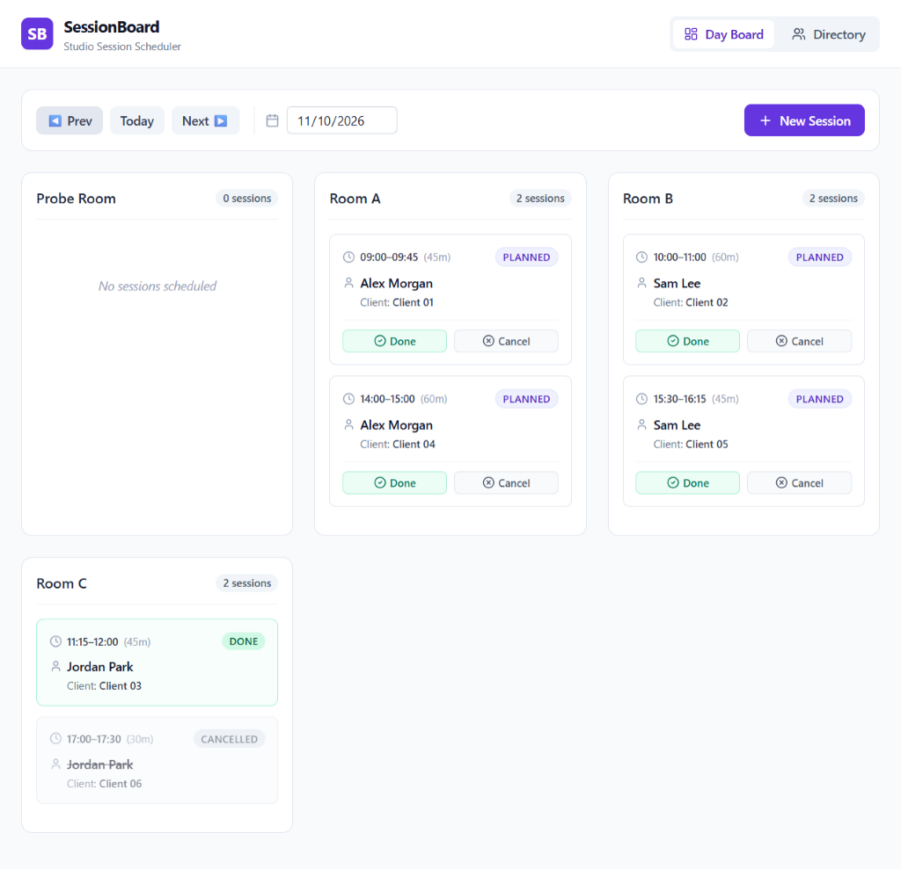
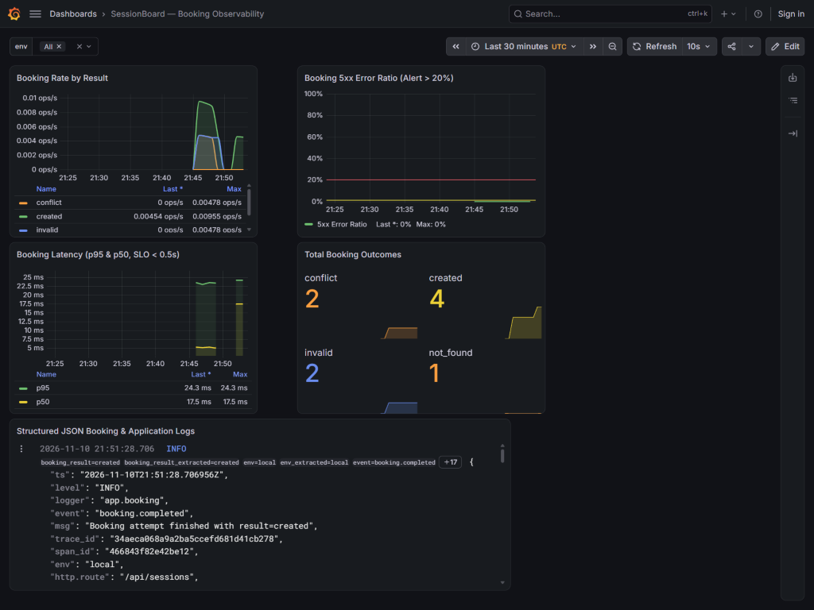
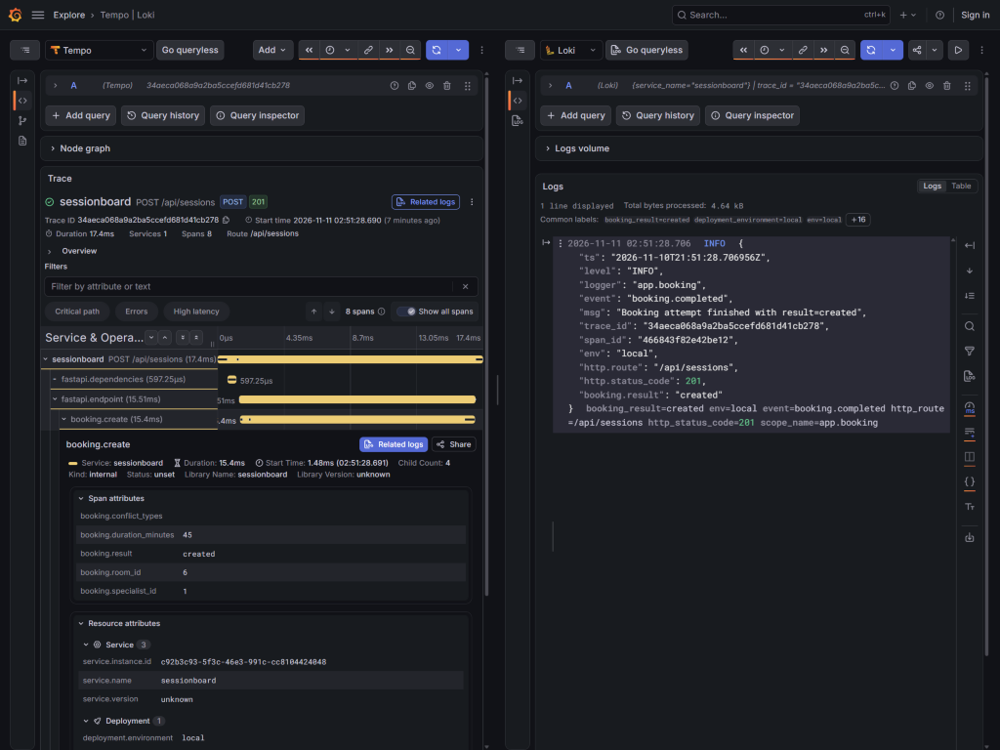

# Course Submission & Peer Reviewer Guide — SessionBoard

> **Course:** [DataTalksClub AI Dev Tools Zoomcamp — Final Project](https://github.com/DataTalksClub/ai-dev-tools-zoomcamp/blob/main/project/README.md)  
> **Repository:** [`brut0/sessionboard`](https://github.com/brut0/sessionboard)  
> **Project Documentation:** See [`README.md`](../README.md) for the classic product & engineering documentation  
> **Self-Assessment:** **12 / 12 Criteria Completed (`24 / 24 Points`)**

This document is structured specifically for **course peer reviewers**. Every section below maps directly to the official grading rubric in [`project/README.md`](https://github.com/DataTalksClub/ai-dev-tools-zoomcamp/blob/main/project/README.md), provides live verification links, and points to the exact files, GitHub Issues, PRs, and GitHub Actions workflow runs proving each criterion.

---

## At-a-Glance: Live Environments & Interactive Endpoints

| Environment | Web App UI | OpenAPI Swagger UI & ReDoc | Health & Version Probes | Notes |
|---|---|---|---|---|
| **Production (`prod`)** | https://sessionboard-prod.onrender.com | [`/docs`](https://sessionboard-prod.onrender.com/docs) · [`/redoc`](https://sessionboard-prod.onrender.com/redoc) | [`/api/health`](https://sessionboard-prod.onrender.com/api/health) · [`/api/version`](https://sessionboard-prod.onrender.com/api/version) | Promoted manually via [`deploy-prod.yml`](../.github/workflows/deploy-prod.yml) (`production` approval gate) |
| **Staging (`dev`)** | https://sessionboard-dev.onrender.com | [`/docs`](https://sessionboard-dev.onrender.com/docs) · [`/redoc`](https://sessionboard-dev.onrender.com/redoc) | [`/api/health`](https://sessionboard-dev.onrender.com/api/health) · [`/api/version`](https://sessionboard-dev.onrender.com/api/version) | Auto-deployed on `main` via [`cd-dev.yml`](../.github/workflows/cd-dev.yml) + hourly synthetic probe + OTLP -> Grafana Cloud |
| **Companion AI SDLC (`ai-sdlc`)** | https://essionboard-ai-sdlc.onrender.com | — *(owner-gated)* | [`/api/health`](https://essionboard-ai-sdlc.onrender.com/api/health) | Decoupled AI workbench (`SDLC_REQUIRE_AUTH=true`; unauthenticated `/api/config` returns `401`) |

> [!NOTE]
> **Render Free Tier Cold-Start Notice (`~30–50s`):** All cloud services run on Render Free plans that automatically spin down after 15 minutes of inactivity. The first request after an idle period may take **30–50 seconds** while the container and Neon PostgreSQL connection wake up; subsequent requests respond in milliseconds.

---

## 🧭 60-Second Peer Reviewer Walkthrough

### Part A — Live Browser Walkthrough (Zero Setup Required)

1. **Explore the Daily & Weekly Schedule (`F3`):**
   - Open https://sessionboard-prod.onrender.com (or [`dev`](https://sessionboard-dev.onrender.com)).
   - Set the date picker to **`2026-11-10`** (where the demo seed dataset is preloaded) to inspect 6 seeded sessions across `Room A`, `Room B`, and `Room C` (`PLANNED`, `DONE`, `CANCELLED`).
   - Toggle between **`Columns`** and **`Gantt Timeline`** (`By Room` / `By Specialist`), test specialist/status filters, click any card to open the slide-over **Session Details Drawer**, and switch to **`Week Overview`** in the left sidebar for the Monday–Sunday weekly matrix.
2. **Trigger an Atomic Double-Booking Refusal (`F2`, `BR-3`, `409 Conflict`):**
   - Click **`+ Book Session`** (or click any empty cell on the Gantt chart).
   - Select Date **`2026-11-10`**, Start **`09:00`**, Duration **`45 min`** (or `60 min`), Specialist **`Alex Morgan`**, Room **`Room A`**, Client **`Client 01`**, and submit.
   - Observe the **`409 Conflict`** error banner explaining the exact overlapping resources (`specialist`, `room`, `client` busy on session `#1`).
3. **Create a Session & Test Lifecycle Cancellation (`F4`, `AC-4.2`):**
   - Book a free slot (for example Date `2026-11-10`, Start `12:30`, Duration `45 min`, Specialist `Alex Morgan`, Room `Room A`, Client `Client 07`).
   - Click the newly created card -> click **`Cancel`** inside the **Session Details Drawer** (`PATCH /api/sessions/{id}`). The slot turns `CANCELLED` and is immediately free to re-book.
4. **Verify Directory Referential Integrity (`F1`, `BR-6`):**
   - Switch to **`Directory`** in the left sidebar.
   - Try deleting a referenced entity such as `Alex Morgan` or `Room A` — the API refuses with `409 Conflict` (`{"detail": "has_planned_sessions"}`). Create a new temporary room or client and delete it cleanly (`204 No Content`).
5. **Inspect Live API Contract & Build Metadata:**
   - Open [Swagger UI (`/docs`)](https://sessionboard-dev.onrender.com/docs), [`/api/health`](https://sessionboard-dev.onrender.com/api/health) (`{"status":"ok","db":"ok"}`), and [`/api/version`](https://sessionboard-dev.onrender.com/api/version) (returns exact deployed git commit SHA and environment).

### Part B — Local One-Command Docker Walkthrough

No `.env` file creation is needed:

```bash
git clone https://github.com/brut0/sessionboard.git
cd sessionboard
docker compose up --build
```

- **App & API:** http://localhost:8000 (seeded automatically on `Today`'s date)
- **Swagger UI:** http://localhost:8000/docs
- **Health Check:** http://localhost:8000/api/health → `{"status":"ok","db":"ok"}`
- **Grafana LGTM (Tempo · Loki · Prometheus):** http://localhost:3000 (`admin` / `admin`)
- *(Optional)* Add `--profile sdlc` to run the Companion AI SDLC Workbench alongside on http://127.0.0.1:8090.

---

## 📊 Summary Rubric Checklist (`12 / 12` Criteria — `24 / 24` Points)

| # | Criterion | Max Pts | Claimed | Quick Jump |
|---:|---|---:|---:|---|
| **1** | **Problem Description** | 2 | **2** | [Evidence & Spec §1](#criterion-1-problem-description-2--2-pts) |
| **2** | **Product Specification** | 2 | **2** | [Specs + Public GitHub Issues](#criterion-2-product-specification--public-task-tracker-2--2-pts) |
| **3** | **Agent Team Specification** | 2 | **2** | [8 Roles + 4 Skills + Process](#criterion-3-agent-team-specification-2--2-pts) |
| **4** | **Context Management** | 2 | **2** | [AGENTS.md + CLAUDE.md Routing](#criterion-4-context-management-2--2-pts) |
| **5** | **Application** | 2 | **2** | [React 19 + FastAPI + PostgreSQL 16](#criterion-5-application-2--2-pts) |
| **6** | **Testing** | 2 | **2** | [110 Automated Tests + Coverage](#criterion-6-testing-unit-integration--frontend-2--2-pts) |
| **7** | **Containerization** | 2 | **2** | [Multi-Stage Dockerfile + Compose](#criterion-7-containerization-2--2-pts) |
| **8** | **Deployment** | 2 | **2** | [Render + Neon `dev` / `prod` / `ai-sdlc`](#criterion-8-deployment-2--2-pts) |
| **9** | **CI/CD** | 3 | **3** | [PR CI -> Auto Dev -> Manual Prod + Rollback](#criterion-9-cicd-3--3-pts) |
| **10** | **Observability** | 2 | **2** | [OTel Tempo + Loki + Prometheus, Zero PII](#criterion-10-observability-2--2-pts) |
| **11** | **Alerting on User Impact** | 1 | **1** | [`BookingErrorRatioHigh` in Grafana Cloud](#criterion-11-alerting-on-user-impact-1--1-pt) |
| **12** | **On-Call Agent** | 2 | **2** | [Cloud On-Call + Chaos Drill `#48`/`#49`](#criterion-12-on-call-responder-agent-2--2-pts) |
| | **Total** | **24** | **24** | — |

---

## 🔍 Criterion-by-Criterion Grading Evidence

### Criterion 1: Problem Description (`2 / 2 pts`)

> *Official rubric (2 pts): "The README clearly describes the problem, the system functionality, and expected behavior."*

- **Primary Evidence:** [`README.md` §1 Product Description, Features & Visual Walkthrough](../README.md#-1-problem-description-features--visual-walkthrough) clearly explains why small 2–5 room studios suffer from accidental multi-resource double bookings (`specialist`, `room`, `client`) when using spreadsheets/chats, and documents expected behavior across Directory (`F1`), Atomic Booking (`F2`), Daily Schedule Columns + Gantt (`F3`), 7-Day Week Overview, and Session Lifecycle Transitions (`F4`).
- **Supporting Spec:** [`specs/product-spec.md` §1–§4](../specs/product-spec.md) covers personas, explicit user stories (`US-1`..`US-4`), 9 invariant Business Rules (`BR-1`..`BR-9`), the deterministic error JSON contract, and §7 Non-Goals.

---

### Criterion 2: Product Specification & Public Task Tracker (`2 / 2 pts`)

> *Official rubric (2 pts): "A specification exists and there's a publicly accessible task tracker. The tasks define acceptance criteria and there's evidence that the agents used the tracker."*

- **Specifications Authored Before Code:**
  - [`specs/constitution.md`](../specs/constitution.md) — non-negotiable stack locks, domain purity (`backend/app/domain/` imports neither SQLAlchemy nor FastAPI), minutes-since-midnight time math, zero-PII telemetry rules, and Definition of Done.
  - [`specs/product-spec.md`](../specs/product-spec.md) — 16 `Given / When / Then` Acceptance Criteria (`AC-1.1`..`AC-4.2`) mapped via a full traceability matrix.
  - [`specs/data-model.md`](../specs/data-model.md), [`specs/nfr-observability.md`](../specs/nfr-observability.md), [`specs/api/openapi.yaml`](../specs/api/openapi.yaml) (14 operations), and [`specs/tasks.md`](../specs/tasks.md) (T01..T16).
- **Public Task Tracker with Agent Evidence:**
  - Open/closed tracker: [GitHub Issues](https://github.com/brut0/sessionboard/issues?q=is%3Aissue) (`#1`–`#17`, `#32`, `#34`, `#48`, `#52`, `#54`, `#56`).
  - **Issue `#1`** ([`Phase gates log`](https://github.com/brut0/sessionboard/issues/1)): contains structured `[orchestrator] Phase <N> gate: PASS` sign-offs for Phases 0–10 with quoted test outputs.
  - Every task issue (`#2`–`#17`, `#52`, `#54`, `#56`) uses [`.github/ISSUE_TEMPLATE/task.yml`](../.github/ISSUE_TEMPLATE/task.yml) with Acceptance Criteria checkboxes, start/finish comments prefixed by `[<agent-role>]`, and matching commits carrying `Agent:` and `Refs: #N` git trailers.

---

### Criterion 3: Agent Team Specification (`2 / 2 pts`)

> *Official rubric (2 pts): "The project defines the agent team and process of how they work together."*

- **Team Architecture & Hand-Offs:** [`docs/agents/team.md`](agents/team.md) and [`docs/ai-tools.md`](ai-tools.md) define an 8-role specialized engineering team and how work flows from Spec -> Architect -> Parallel TDD (Backend, Frontend, QA) -> Reviewer -> DevOps -> On-Call Responder.
- **Role Prompts (`.agents/roles/`):** [`spec.md`](../.agents/roles/spec.md), [`architect.md`](../.agents/roles/architect.md), [`backend.md`](../.agents/roles/backend.md), [`frontend.md`](../.agents/roles/frontend.md), [`qa.md`](../.agents/roles/qa.md), [`reviewer.md`](../.agents/roles/reviewer.md), [`devops.md`](../.agents/roles/devops.md), and [`oncall.md`](../.agents/roles/oncall.md).
- **Workflow Skills (`.agents/skills/`):** [`feature-sdlc`](../.agents/skills/feature-sdlc/SKILL.md), [`issue-workflow`](../.agents/skills/issue-workflow/SKILL.md), [`phase-gate`](../.agents/skills/phase-gate/SKILL.md), and [`release-and-rollback`](../.agents/skills/release-and-rollback/SKILL.md), plus [`docs/plan/EXECUTION_GUIDE.md`](plan/EXECUTION_GUIDE.md) and [`docs/process.md`](process.md).

---

### Criterion 4: Context Management (`2 / 2 pts`)

> *Official rubric (2 pts): "AGENTS.md exists and it also points to modular docs (process, teams, etc.)."*

- Root [`AGENTS.md`](../AGENTS.md) (45 lines) acts as the concise context entrypoint and routes agents to modular documentation:
  - Specs: [`specs/constitution.md`](../specs/constitution.md), [`specs/product-spec.md`](../specs/product-spec.md), [`specs/api/openapi.yaml`](../specs/api/openapi.yaml)
  - Engineering docs: [`docs/process.md`](process.md), [`docs/agents/team.md`](agents/team.md), [`docs/architecture.md`](architecture.md), [`docs/adr/`](adr/0001-stack.md), [`docs/testing.md`](testing.md), [`docs/deployment.md`](deployment.md), [`docs/observability.md`](observability.md), [`docs/oncall-demo.md`](oncall-demo.md), [`docs/ai-tools.md`](ai-tools.md), [`docs/ai-sdlc.md`](ai-sdlc.md), [`docs/SUBMISSION.md`](SUBMISSION.md)
  - Operations & planning: [`docs/runbooks/booking-errors.md`](runbooks/booking-errors.md), [`docs/plan/MASTER_PLAN.md`](plan/MASTER_PLAN.md), [`docs/plan/EXECUTION_GUIDE.md`](plan/EXECUTION_GUIDE.md)
- Companion [`CLAUDE.md`](../CLAUDE.md) delegates directly to `AGENTS.md` and shared [`.agents/references/verification-commands.md`](../.agents/references/verification-commands.md).

---

### Criterion 5: Application (`2 / 2 pts`)

> *Official rubric (2 pts): "Full-stack application works end to end: frontend talks to backend, data persists in a database. Application runs locally with a single command."*

- **Backend:** Python 3.12 + FastAPI (`backend/app/main.py`) + OpenAPI 3.1 typed contract + SQLAlchemy 2.x (`psycopg 3`) + Alembic forward migrations ([`0001_initial_schema.py`](../backend/alembic/versions/0001_initial_schema.py)) + pure domain conflict engine ([`backend/app/domain/conflicts.py`](../backend/app/domain/conflicts.py) & [`time_utils.py`](../backend/app/domain/time_utils.py)).
- **Concurrency Safety:** Session booking executes inside a PostgreSQL transaction protected by a date-scoped advisory lock (`pg_advisory_xact_lock`), guaranteeing two simultaneous booking requests for the same date/resource never double-book.
- **Frontend:** React 19 + TypeScript + Vite SPA built into `backend/app/static/` (`App` Left Sidebar, `DayBoard` Columns & `08:00–20:00` Gantt Timeline + KPI/filter ribbon + Session Drawer, `WeekBoard` 7-day matrix, `BookingModal`, `DirectoryPage`), using generated types from [`specs/api/openapi.yaml`](../specs/api/openapi.yaml).
- **Single-Command Launch:** `docker compose up --build` starts DB, applies Alembic migrations, seeds synthetic data cleanly, and serves UI + API on http://localhost:8000.



---

### Criterion 6: Testing: Unit, Integration & Frontend (`2 / 2 pts`)

> *Official rubric (2 pts): "Both unit and integration tests exist, run with a single command, and pass."*

All **110 automated tests** run via GitHub Actions on every PR and locally via `make test` (plus `make test-ai-sdlc` for the companion workbench):

| Suite | Location & Tooling | Tests Passed | Line Coverage | What It Verifies |
|---|---|---:|---:|---|
| **Backend Unit & Telemetry/Ops** | `backend/tests/unit/` (`pytest`) | Included in 49 | `100%` on `domain/` | Overlap interval rules, touching boundaries, midnight overflow guard (`time_utils.py`), `JsonLogFormatter`, alert rule / workflow / synthetic probe contracts |
| **Backend Integration & Contract** | `backend/tests/integration/` (`pytest` + `testcontainers` PostgreSQL 16) | Included in **49 passed** | **90%** overall | Real PostgreSQL 16 + Alembic execution covering `AC-1.1`..`AC-4.2`, concurrent booking lock behavior, OpenAPI 3.1 route/status parity (`test_openapi_contract.py`), zero-PII canary telemetry test (`test_telemetry_no_pii.py`) |
| **Frontend Component & MSW** | `frontend/src/**/*.test.tsx` (`vitest` + `@testing-library/react` + `msw`) | **21 passed** | **93.84%** | Left Sidebar view switching, DayBoard Columns/Gantt/Filters/Drawer, WeekBoard 7-day matrix, BookingModal 15-min constraints & 409/500 `X-Trace-Id` handling, Directory CRUD |
| **Companion AI SDLC** | `tools/ai-sdlc/tests/` (`pytest`) | **40 passed** | **78%** | Owner auth fail-closed `503`/`401`/`429`/`403`, path traversal protection, English hygiene, spec-first `409` lock, surgical search/replace edits, LLM secret redaction |

**Reviewer Verification Commands (Cross-Platform):**
- **Linux / macOS / Make:** `make test` (runs backend + frontend) and `make test-ai-sdlc`
- **Windows PowerShell (no `make` required; Docker Desktop running for `testcontainers`):**
  ```powershell
  cd backend; uv run pytest -v; cd ..
  cd frontend; npm test; cd ..
  cd tools/ai-sdlc; uv run pytest -v; cd ..\..
  ```
- **Latest CI Evidence:** Run [`#43608954467`](https://github.com/brut0/sessionboard/actions/runs/43608954467) (`5/5` jobs green, per-module coverage tables published to `$GITHUB_STEP_SUMMARY`) and [`docs/testing.md`](testing.md).

---

### Criterion 7: Containerization (`2 / 2 pts`)

> *Official rubric (2 pts): "The full system, including the database, runs via Docker or Docker Compose and starts with a single command."*

- **App Image:** Multi-stage [`Dockerfile`](../Dockerfile) (`node:22-alpine` builds the React/TypeScript SPA -> `python:3.12-slim` runs `alembic upgrade head && app.seed` and serves SPA + FastAPI on port `8000` as non-root `appuser`).
- **Full Stack Compose:** [`docker-compose.yml`](../docker-compose.yml) runs `db` (`postgres:16-alpine` with `pg_isready` healthcheck and persistent `pgdata` volume), `app` (`sessionboard` waiting on healthy `db`), and `otel-lgtm` (`grafana/otel-lgtm:latest` on `:3000`). Adding `--profile sdlc` optionally boots the decoupled [`tools/ai-sdlc/Dockerfile`](../tools/ai-sdlc/Dockerfile) service on `127.0.0.1:8090`.
- **Fresh-Clone Proof:** Verified on a clean git clone (`c0d9b61`) via `docker compose up --build -d` -> `http://localhost:8000/api/health` returned `{"status":"ok","db":"ok"}` and `http://localhost:3000/api/health` returned `{"database": "ok", ...}` (recorded in [Issue `#1` Phase 10 Gate](https://github.com/brut0/sessionboard/issues/1#issuecomment-6876454439)).

---

### Criterion 8: Deployment (`2 / 2 pts`)

> *Official rubric (2 pts): "The application is deployed and reachable at a public URL, or there's a clear demo with the deployment."*

- **Three Live Cloud Services on Render + Two Isolated Neon PostgreSQL 16 Databases:**
  - **Production:** https://sessionboard-prod.onrender.com (Neon `sessionboard-prod`, manual approval gate)
  - **Staging (`dev`):** https://sessionboard-dev.onrender.com (Neon `sessionboard-dev`, auto-deployed from `main` + Grafana Cloud OTLP telemetry + hourly synthetic probe)
  - **Owner-Gated Companion AI SDLC:** https://essionboard-ai-sdlc.onrender.com (`SDLC_REQUIRE_AUTH=true`, public `/api/health` + `401` on protected routes)
- Detailed infrastructure topology and evidence table in [`docs/deployment.md`](deployment.md).

---

### Criterion 9: CI/CD (`3 / 3 pts`)

> *Official rubric (3 pts): "CI runs tests, CD deploys to dev, and there's a manual deploy to production."*

1. **Pull Request CI ([`.github/workflows/ci.yml`](../.github/workflows/ci.yml)):** Runs 5 parallel jobs enforced by branch protection (`Repository Hygiene`, `Backend Lint & Tests`, `Frontend Lint & Tests`, `AI SDLC Workbench Tests`, `Docker Build`), e.g. [`#43608954467`](https://github.com/brut0/sessionboard/actions/runs/43608954467).
2. **Automatic CD to Staging ([`.github/workflows/cd-dev.yml`](../.github/workflows/cd-dev.yml)):** On every push to `main`, re-runs tests, builds immutable GHCR images (`ghcr.io/brut0/sessionboard:<sha>` & `sessionboard-ai-sdlc:<sha>`), triggers Render Deploy Hooks with `&imgURL=...`, polls `/api/version` until the live commit matches `$GITHUB_SHA`, and runs `synthetic_probe.py --mode once` (e.g. [`#43609098293`](https://github.com/brut0/sessionboard/actions/runs/43609098293)).
3. **Manual Production Promotion ([`.github/workflows/deploy-prod.yml`](../.github/workflows/deploy-prod.yml)):** `workflow_dispatch` taking target `sha`, protected by GitHub Environment **`production` required reviewer approval**, verifying the exact GHCR manifest before deploying (proven runs: [`#42887628791`](https://github.com/brut0/sessionboard/actions/runs/42887628791) and [`#43596303982`](https://github.com/brut0/sessionboard/actions/runs/43596303982)).
4. **Deterministic Rollback ([`.github/workflows/rollback.yml`](../.github/workflows/rollback.yml)):** Accepts any historical `<sha>` on `dev` or `prod` (`dev` immediate; `prod` gated), rolls back Render to that immutable GHCR digest, and verifies `/api/version` (proven runs: [`#42887682401`](https://github.com/brut0/sessionboard/actions/runs/42887682401) and [`#43586452777`](https://github.com/brut0/sessionboard/actions/runs/43586452777)).

---

### Criterion 10: Observability (`2 / 2 pts`)

> *Official rubric (2 pts): "A key user journey is instrumented with metrics, traces, and structured logs that share a trace ID; no customer data or credentials are sent to telemetry; and the signals are collected, stored, and viewable in a UI."*

- **Key User Journey (`POST /api/sessions`):**
  - **Traces:** Child span `booking.create` inside ASGI server traces + SQLAlchemy query spans, returning `X-Trace-Id` on every HTTP response (`201`, `409`, `422`, `404`, `500`).
  - **Metrics:** Low-cardinality Prometheus counters/histograms `sessionboard_bookings_total{result,env}` and `sessionboard_booking_duration_seconds` tracking SLO compliance (< 500ms p95, < 20% 5xx ratio).
  - **Structured Logs:** Single-line JSON logs containing `trace_id`, `span_id`, `event`, `http.route`, `http.status_code`, and `booking.result` via [`backend/app/logging_config.py`](../backend/app/logging_config.py).
- **Zero-PII Enforcement:** Verified automatically in CI by [`test_telemetry_no_pii.py`](../backend/tests/integration/test_telemetry_no_pii.py) using canary specialist/client/room names and simulated `500` tracebacks.
- **Collection & UI:** Works out-of-the-box locally via `otel-lgtm` (`http://localhost:3000`, provisioned dashboard [`ops/grafana/dashboard.json`](../ops/grafana/dashboard.json)) AND live in **Grafana Cloud** (`Tempo`, `Loki`, `Mimir`) for `sessionboard-dev` ([`docs/observability.md`](observability.md)).

| Grafana SLIs & Error Ratio Dashboard | Tempo Trace -> Correlated Loki JSON Logs (`trace_id`) |
|---|---|
|  |  |

---

### Criterion 11: Alerting on User Impact (`1 / 1 pt`)

> *Official rubric (1 pt): "At least one alert exists."*

- **Alert Rule:** [`ops/grafana/alert-rule.json`](../ops/grafana/alert-rule.json) — **`BookingErrorRatioHigh`** (Grafana Cloud UID `ag49ldardj6dce`, evaluated every `60s`, pending threshold `2m`, firing expression `$B >= 3 && ($A / $B) > 0.2` over a 5-minute rolling window on `sessionboard_bookings_total{env="dev"}` so noise/single blips do not page, while genuine user booking failures fire within 2–3 minutes).
- **Contact Point Dispatch:** [`ops/grafana/contact-point-payload.tmpl`](../ops/grafana/contact-point-payload.tmpl) dispatches Grafana Cloud firing/resolved webhooks directly to GitHub Actions `repository_dispatch` (`event_type: grafana-alert`).
- **Live Proof:** Verified transitioning `inactive -> pending -> firing -> Normal` in Grafana Cloud during the Chaos Drill documented in [`docs/oncall-demo.md`](oncall-demo.md).

---

### Criterion 12: On-Call Responder Agent (`2 / 2 pts`)

> *Official rubric (2 pts): "An agent wakes up on an alert and fixes the issue."*

- **Serverless Responder Workflow:** [`.github/workflows/oncall.yml`](../.github/workflows/oncall.yml) + runbook [`docs/runbooks/booking-errors.md`](runbooks/booking-errors.md).
- **End-to-End Live Chaos Drill ([`docs/oncall-demo.md`](oncall-demo.md)):**
  1. **Fault Injection & User Impact:** Drill PR `#47` (`9a7dd8f`) introduced an arithmetic bug rejecting `:45/+30m` bookings; hourly/burst [`synthetic-probe.yml` #43586140601](https://github.com/brut0/sessionboard/actions/runs/43586140601) drove real booking error ratio above 20% in Grafana Cloud (`inactive -> pending -> firing`).
  2. **Wake-Up & Deterministic Mitigation:** Grafana Cloud webhook triggered [`oncall.yml` #43586436665](https://github.com/brut0/sessionboard/actions/runs/43586436665), which opened [Incident `#48`](https://github.com/brut0/sessionboard/issues/48) and immediately triggered deterministic rollback [`rollback.yml` #43586452777](https://github.com/brut0/sessionboard/actions/runs/43586452777) restoring `sessionboard-dev` to `3b3cb8f`.
  3. **Root-Cause Diagnosis & Autonomous Fix PR:** `oncall.yml` pulled zero-PII error logs from Grafana Cloud Loki (`status=200`, `error_lines_30m=18`, `total_lines_60m=20`), invoked headless **Gemini CLI** (`gemini-3.1-flash-lite`) with the runbook and failing logs, fixed [`backend/app/domain/time_utils.py`](../backend/app/domain/time_utils.py) + tests (`49 passed`), and opened [`PR #49`](https://github.com/brut0/sessionboard/pull/49).
  4. **Verification & Recovery:** PR `#49` passed CI [`#43586622025`](https://github.com/brut0/sessionboard/actions/runs/43586622025), auto-merged into `main`, automatically closed Incident `#48`, deployed cleanly via [`cd-dev.yml` #43586718427](https://github.com/brut0/sessionboard/actions/runs/43586718427), and triggered the Grafana Cloud `resolved` webhook [`#43586823690`](https://github.com/brut0/sessionboard/actions/runs/43586823690).
