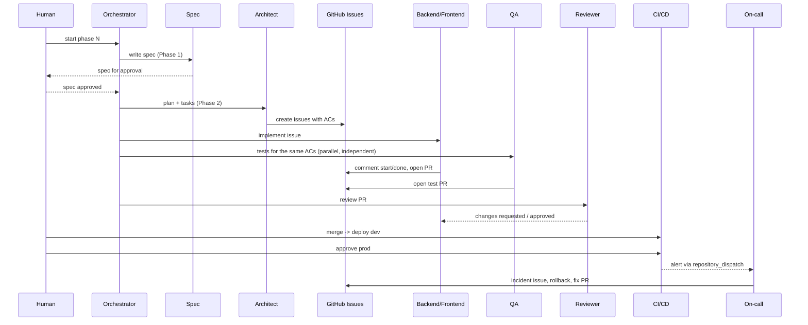

# Agent Team

The project is built by a small team of AI agents with explicit roles, orchestrated by one
orchestrator session in Google Antigravity and supervised by a human owner. Each role has a
system prompt in `.agents/roles/<role>.md`; repeatable procedures live in `.agents/skills/`.

## Roles

| Role | Prompt | Responsibility | Inputs | Outputs | May edit |
|---|---|---|---|---|---|
| Human owner | — | Approves spec and tasks, merges PRs, approves prod deploys, owns accounts and secrets | everything | decisions | everything |
| Orchestrator | `docs/plan/EXECUTION_GUIDE.md` | Runs one phase, dispatches role agents per issue, enforces gates | master plan, issues | phase report | `specs/tasks.md`, issue comments |
| Spec agent | `.agents/roles/spec.md` | Constitution, product spec, ACs, clarifications, README | idea, course criteria, plan | `specs/constitution.md`, `specs/product-spec.md`, `specs/nfr-observability.md`, `README.md` | `specs/`, `README.md`, `docs/ai-tools.md` |
| Architect agent | `.agents/roles/architect.md` | Data model, OpenAPI contract, architecture, ADRs, task breakdown | approved spec | `specs/data-model.md`, `specs/api/openapi.yaml`, `docs/architecture.md`, `docs/adr/`, issues | `specs/`, `docs/` |
| Backend agent | `.agents/roles/backend.md` | API, domain, persistence, telemetry code via TDD | issue, contract | PR | `backend/` |
| Frontend agent | `.agents/roles/frontend.md` | UI against the generated client | issue, contract | PR | `frontend/` |
| QA agent | `.agents/roles/qa.md` | Tests derived from ACs, independent of the implementer | ACs, contract | test PRs | `backend/tests/`, `frontend/src/**/*.test.tsx` |
| Reviewer agent | `.agents/roles/reviewer.md` | Reviews every PR against spec, constitution, and this process | PR diff | review | nothing (comments only) |
| DevOps agent | `.agents/roles/devops.md` | Docker, CI/CD, deploy, rollback, telemetry pipeline, alerting | plan, NFRs | workflows, compose, `ops/`, deployment docs | `.github/`, `Dockerfile`, `docker-compose.yml`, `Makefile`, `ops/`, `scripts/`, `docs/deployment.md`, `docs/observability.md` |
| On-call agent | `.agents/roles/oncall.md` | Wakes on an alert in CI, mitigates by rollback, writes a regression test and a fix | alert payload, runbook, logs, diff | incident comments, fix PR | `backend/` |

## How they work together

## Hand-off rules

1. Work units are GitHub issues. No issue → no work.
2. Backend and Frontend start only after `specs/api/openapi.yaml` is merged; they work in parallel on separate branches.
3. QA writes tests from ACs **without reading the implementation first**; a mismatch is resolved by the spec, not by changing the test to fit the code.
4. The Reviewer never edits code; it returns findings with file:line and the violated rule.
5. Every agent ends its run with the report format in its role prompt so the orchestrator can paste it into the issue.
6. Escalate to the human: spec ambiguity, failing gate after two attempts, any need for credentials or paid services.
