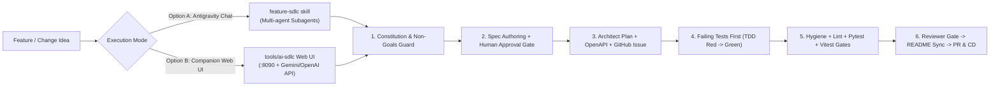

# Dual AI SDLC Pipeline (Post-MVP Features & Changes)

SessionBoard supports **two equivalent, spec-driven AI SDLC workflows** for adding new features, enhancing behavior, or fixing bugs after the initial build phases. Both pipelines share the exact same engineering invariants from [`AGENTS.md`](../AGENTS.md), [`specs/constitution.md`](../specs/constitution.md), and [`.agents/roles/*.md`](../.agents/roles/).



---

## Option A — Chat-Native AI SDLC inside Antigravity

Trigger the full orchestrator workflow directly from Antigravity chat using [`.agents/skills/feature-sdlc/SKILL.md`](../.agents/skills/feature-sdlc/SKILL.md).

### How to Trigger
Paste any prompt like:

```text
Use the feature-sdlc skill to implement: <describe your feature or bug fix>.
Stop after Stage 1 (Spec) for my "spec approved" before changing OpenAPI or code.
```

### What Happens Automatically
1. **Constitution & Scope Check:** Verifies your request does not violate [`specs/product-spec.md`](../specs/product-spec.md) §7 Non-Goals, zero-PII telemetry rules, or domain purity.
2. **Spec Agent (`.agents/roles/spec.md`):** Updates `specs/product-spec.md` with Business Rules + Given/When/Then ACs and waits for your `"spec approved"`.
3. **Architect Agent (`.agents/roles/architect.md`):** Updates `specs/api/openapi.yaml` (linted with Redocly), `specs/data-model.md` (expand-only migrations), `specs/tasks.md`, and creates a GitHub Issue.
4. **Parallel TDD Dispatch:** Dispatches `qa-agent` (independent `test_ac_*` integration tests), `backend-agent` (domain + Alembic + router), and `frontend-agent` (`npm run gen:api` + Vitest/RTL/MSW + UI).
5. **Verification & Review Gates:** Runs `check_repo_hygiene.py`, `ruff`, `pytest`, `tsc --noEmit`, `vitest`, and `reviewer-agent` 10-point audit.
6. **Delivery:** Syncs `README.md`, opens the PR via `gh`, monitors CI checks, and comments gate evidence on the issue.

---

## Option B — Companion Web Workbench (`tools/ai-sdlc/`) with LLM API Access

When you want a visual, interactive control plane next to SessionBoard (`http://localhost:8090` alongside `:8000`) connected directly to **Google Gemini** or **OpenAI-compatible** APIs:

### 1. Launch Alongside SessionBoard

```powershell
# Terminal 1 (SessionBoard target app, optional for live smoke checks)
docker compose up --build

# Terminal 2 (Companion AI SDLC Web Workbench)
cd tools\ai-sdlc
uv sync
uv run uvicorn sdlc_app.main:app --host 127.0.0.1 --port 8090 --reload
```
Open **http://127.0.0.1:8090**, click **API Settings**, select **Google Gemini API** (`gemini-2.5-flash`) or **OpenAI-Compatible API**, and paste your API key (stored only in git-ignored `.local/ai-sdlc/config.json`).

### 2. Workbench Capabilities
- **Stage 1 (Intake):** Analyzes the feature against `specs/constitution.md` and Non-Goals, generates clarifying questions, and proposes a clean `feat/<slug>` branch name.
- **Stage 2 (Spec + Human Approval Lock):** Drafts `specs/product-spec.md` updates (`BR-*`, `AC-*`), displays unified diffs, applies patches safely, and keeps **Architect / TDD stages locked (`HTTP 409`)** until you explicitly click **Approve Spec**.
- **Stage 3 (Architect & GitHub Issue):** Updates `specs/api/openapi.yaml` / `specs/data-model.md` / `specs/tasks.md` and creates the real GitHub Issue via `gh issue create`.
- **Stage 4 (TDD Tests First -> Implement -> Optional Headless Gemini CLI):**
  - **4a (`tdd_tests`):** Generates failing test patches first so you can verify RED in the Gate Console.
  - **4b (`implement`):** Generates minimal production patches matching the tests and OpenAPI schema.
  - **Optional Headless CLI:** Runs local `gemini --yolo` directly against the workspace if installed.
- **Stage 5 (Live Verification Console + AI Fixer):** Executes `hygiene`, `ruff`, `pytest`, `typecheck` + `vitest`, `redocly lint`, `npm run gen:api`, and `tools/ai-sdlc` tests with one-click **"Send Last Failure to AI Fixer"**.
- **Stage 6 (AI Reviewer + Branch / Trailers Commit / PR):** Runs `.agents/roles/reviewer.md` against `git diff HEAD`, creates feature branches (never touching `main`), commits with `Agent:` & `Refs: #N` trailers, and opens the PR via `gh pr create`.

### Built-in Safety Guardrails
- **Path Containment:** Patches outside the repo root or targeting `.git/`, `.local/`, `.env`, `node_modules/`, `frontend/dist/`, or `backend/app/static/` are rejected before any disk write.
- **Hygiene Pre-Flight:** Every proposed file patch, branch name, commit message, issue, and PR body is scanned for Cyrillic characters and `.local/forbidden-terms.txt` regexes (`HTTP 422` on violation).
- **Decoupled from SessionBoard:** `tools/` is excluded in `.dockerignore` and isolated in its own `uv` environment so SessionBoard's OpenAPI contract tests and container build stay completely unaffected.
