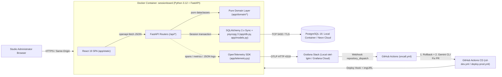
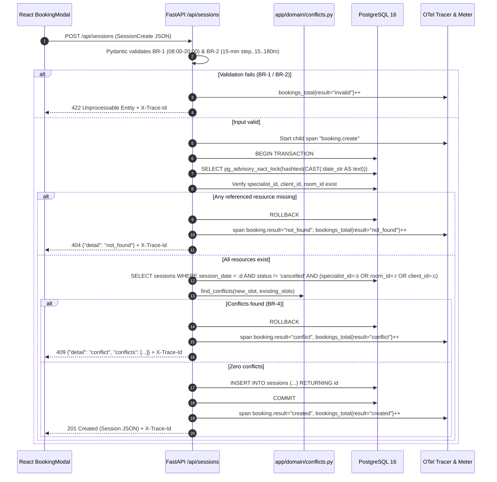

# System Architecture

> **Status:** Approved v1 (Phase 2)
> **Source of truth for:** Component boundaries, layering rules, request/booking flows, and observability integration.

---

## 1. High-Level Component Diagram

---

## 2. Strict Layering & Dependency Rules

| Layer | Files | Allowed Imports | Forbidden Imports |
|---|---|---|---|
| **Domain (Pure)** | `backend/app/domain/time_utils.py`, `backend/app/domain/conflicts.py` | Python stdlib (`dataclasses`, `typing`) | `sqlalchemy`, `fastapi`, `pydantic`, `app.models`, `app.db`, `app.schemas` |
| **Schemas (DTOs)** | `backend/app/schemas.py` | `pydantic`, `datetime`, `app.domain.time_utils` | `sqlalchemy`, `fastapi`, `app.models`, `app.db` |
| **Persistence (ORM)** | `backend/app/db.py`, `backend/app/models.py` | `sqlalchemy`, `psycopg`, `app.config` | `fastapi`, `app.api` |
| **API / Transport** | `backend/app/api/{system,directory,sessions}.py`, `backend/app/main.py` | `fastapi`, `sqlalchemy`, `app.schemas`, `app.models`, `app.domain`, `app.telemetry` | Direct raw SQL outside advisory lock / health probe |
| **Frontend UI** | `frontend/src/{pages,components,api}/` | `openapi-fetch`, generated `src/api/schema.d.ts`, React 19 | Hand-written API request/response interfaces |

---

## 3. Booking Sequence Diagram (`POST /api/sessions`)

---

## 4. Static SPA Serving & Single-Container Topology

In production and `docker compose up --build`, the React 19 frontend is built in Stage 1 of the `Dockerfile` (`node:22-alpine`) and copied into `/app/backend/app/static`. FastAPI mounts `/assets` via `StaticFiles` and serves `index.html` at `/` (and any non-`/api` GET path), eliminating CORS issues in production and allowing the entire application to deploy as a single container image on Render Free.
