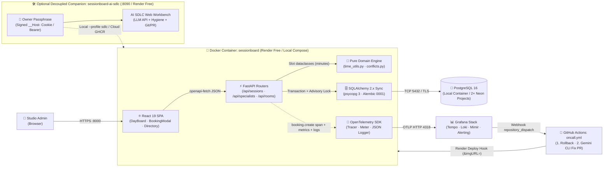
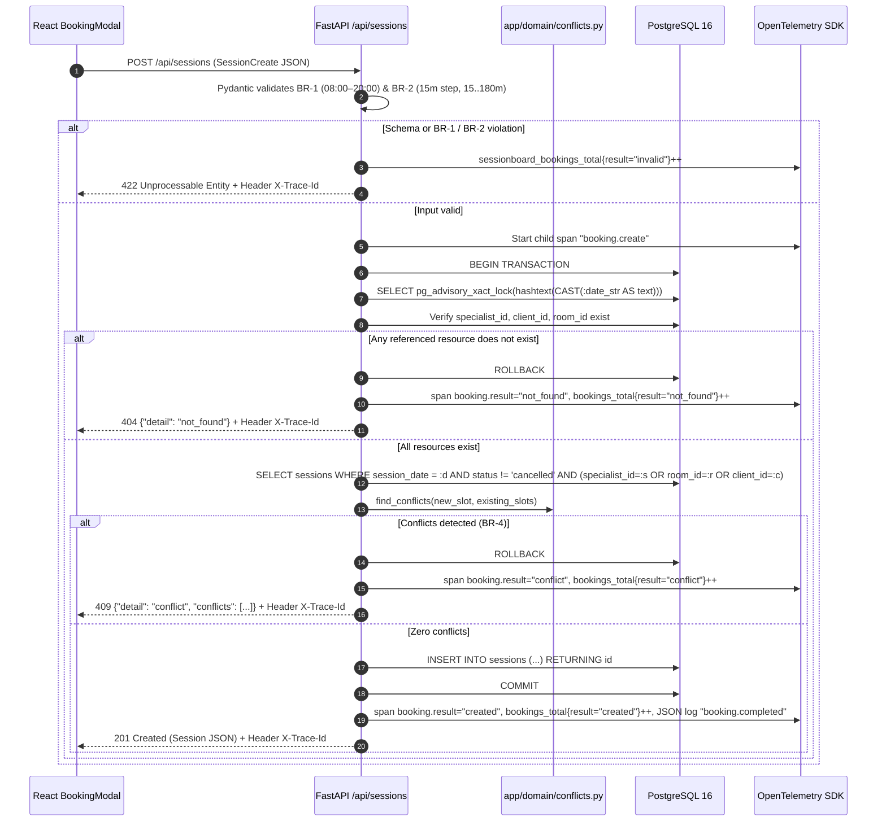
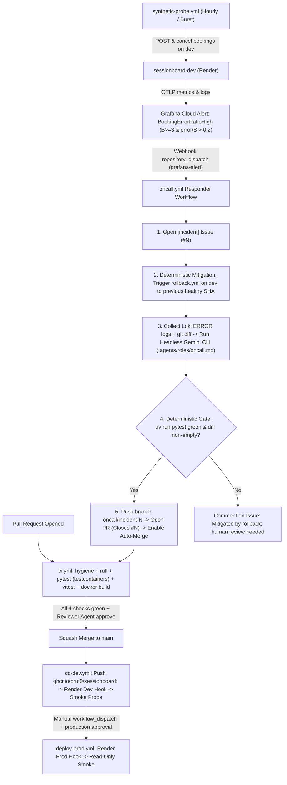

# System Architecture

> **Status:** Approved v1 (Phase 2)
> **Interactive Explorer:** Open [`docs/architecture-explorer.html`](architecture-explorer.html) in any browser for an interactive, multi-mode Archify-style diagram viewer (with upstream/downstream node tracing, dark/light theme toggle, and animated flow playback).
> **Source of truth for:** Component boundaries, layering rules, request/booking flows, database schema, CI/CD promotion, and on-call remediation.

---

## 1. Executive Summary (Conclusion First)

**SessionBoard** is engineered around four architectural invariants:
1. **Single-Container Topology (`ADR-0001`):** A multi-stage `Dockerfile` builds the React 19 + TypeScript SPA in Node 22 and embeds the compiled static assets into the Python 3.12 + FastAPI runtime container (`backend/app/static`). FastAPI serves both `/api/*` and the SPA on a single port (`${PORT:-8000}`), eliminating cross-origin issues and cutting cloud compute usage in half.
2. **Pure Domain + Date-Scoped Advisory Locks (`ADR-0003`):** Interval conflict detection (`backend/app/domain/conflicts.py`) is 100% pure Python operating on integer minutes since midnight (`0..1440`). Concurrent bookings on the same date are serialized inside PostgreSQL 16 via `SELECT pg_advisory_xact_lock(hashtext(CAST(:date_str AS text)))`, preventing race-condition double bookings without locking unrelated dates.
3. **Contract-First Type Safety:** `specs/api/openapi.yaml` (OpenAPI 3.1) is authored before code. Backend routes are verified against it via `test_openapi_contract.py`, and frontend TypeScript types are generated automatically via `openapi-typescript` + `openapi-fetch`.
4. **Zero-PII Observability & Rollback-First On-Call (`ADR-0002`):** Every booking emits correlated OpenTelemetry traces (`booking.create`), low-cardinality Prometheus metrics (`sessionboard_bookings_total{result,env}`), and JSON logs sharing `trace_id` (`X-Trace-Id` response header) with zero personal names. When Grafana's `BookingErrorRatioHigh` alert fires, GitHub Actions (`oncall.yml`) **deterministically rolls back `dev` first**, and then invokes headless **Gemini CLI** to author a regression test and fix PR gated by `pytest`.

---

## 2. Runtime & Cloud Topology Diagram

---

## 3. Strict Layering & Dependency Matrix

| Layer | Directory / Files | Allowed Imports | Forbidden Imports (Enforced by Review & Tests) |
|---|---|---|---|
| **1. Pure Domain** | `backend/app/domain/time_utils.py` `backend/app/domain/conflicts.py` | Python stdlib only (`dataclasses`, `typing`) | `sqlalchemy`, `fastapi`, `pydantic`, `app.models`, `app.db`, `app.schemas` |
| **2. DTO Schemas** | `backend/app/schemas.py` | `pydantic`, `datetime`, `app.domain.time_utils` | `sqlalchemy`, `fastapi`, `app.models`, `app.db` |
| **3. Persistence (ORM)** | `backend/app/db.py` `backend/app/models.py` `backend/app/seed.py` | `sqlalchemy`, `psycopg`, `app.config` | `fastapi`, `app.api` |
| **4. API / Transport** | `backend/app/api/{system,directory,sessions}.py` `backend/app/main.py` | `fastapi`, `sqlalchemy`, `app.schemas`, `app.models`, `app.domain`, `app.telemetry` | Raw SQL outside advisory lock and `/api/health` probe |
| **5. Frontend UI** | `frontend/src/{pages,components,api}/` | `react`, `openapi-fetch`, generated `src/api/schema.d.ts` | Hand-written API request/response TypeScript interfaces |

---

## 4. Atomic Booking & Conflict Detection Sequence (`POST /api/sessions`)

---

## 5. Session Lifecycle State Machine (`US-4`, `BR-5`)

```mermaid
stateDiagram-v2
  [*] --> planned : POST /api/sessions (201 Created)<br/>Blocks overlapping specialist, room & client slots

  planned --> done : PATCH /api/sessions/{id} {"status": "done"} (200 OK)<br/>Preserved in history; continues to block overlaps
  planned --> cancelled : PATCH /api/sessions/{id} {"status": "cancelled"} (200 OK)<br/>Immediately releases specialist, room & client slots

  done --> done : Any PATCH -> 409 invalid_status_transition
  cancelled --> cancelled : Any PATCH -> 409 invalid_status_transition
```

---

## 6. CI/CD Promotion, Rollback & Self-Healing On-Call Pipeline

---

## 7. Architecture Decision Records (ADRs)

| ADR | Title | Key Decision |
|---|---|---|
| [`docs/adr/0001-stack.md`](adr/0001-stack.md) | Core Technology Stack & Single-Container Topology | FastAPI + React 19 SPA compiled into one container image; contract-first OpenAPI client generation. |
| [`docs/adr/0002-hosting-and-telemetry.md`](adr/0002-hosting-and-telemetry.md) | Zero-Cost Cloud Hosting, Telemetry Stack & Headless On-Call | Render Free + 2 isolated Neon Free projects + Grafana Cloud Free + rollback-first headless Gemini CLI responder. |
| [`docs/adr/0003-sync-sqlalchemy.md`](adr/0003-sync-sqlalchemy.md) | Synchronous SQLAlchemy 2.x with `psycopg 3` & Date Advisory Locks | Sync engine avoids Windows async event-loop issues; transaction-scoped `pg_advisory_xact_lock` prevents race-condition double bookings. |
