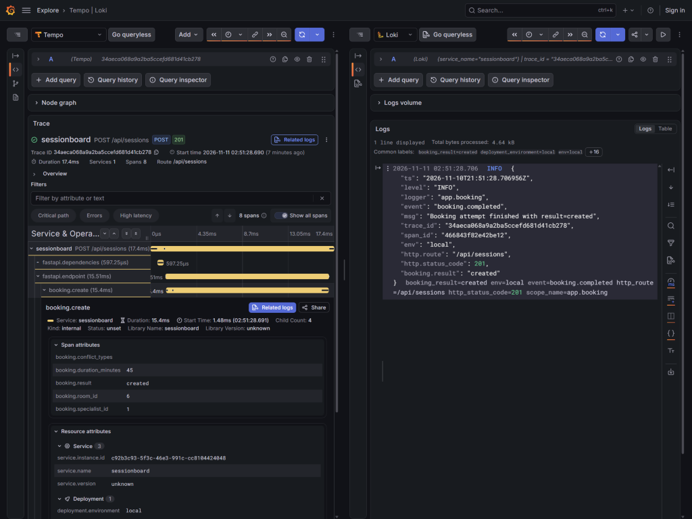
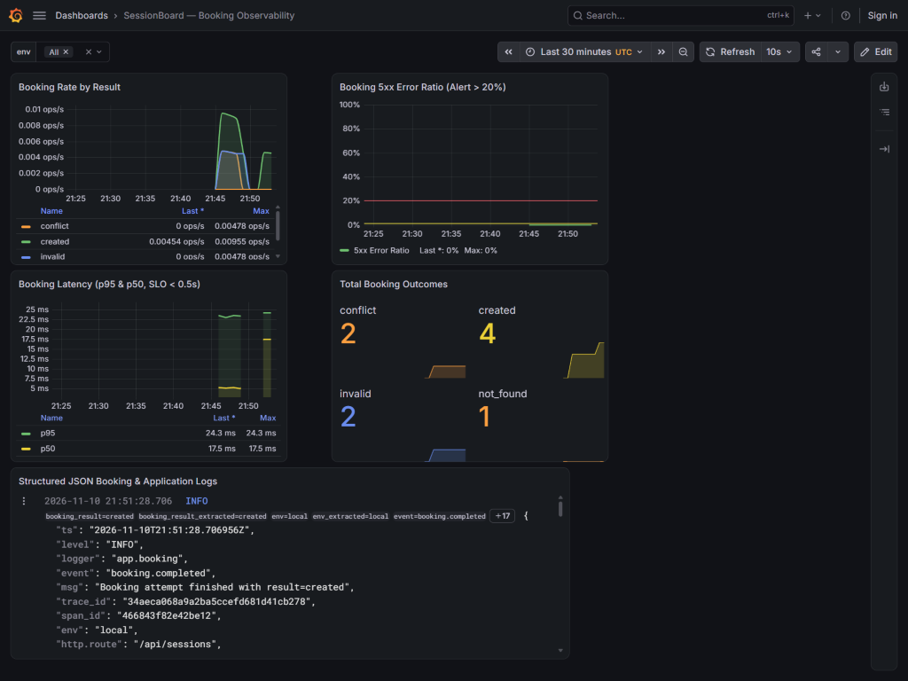

# SessionBoard — OpenTelemetry Observability Guide

> **Spec Reference:** [`specs/nfr-observability.md`](../specs/nfr-observability.md)
> **Dashboard Export:** [`ops/grafana/dashboard.json`](../ops/grafana/dashboard.json)
> **Zero-PII Verification:** [`backend/tests/integration/test_telemetry_no_pii.py`](../backend/tests/integration/test_telemetry_no_pii.py)

---

## 1. Signal Architecture (Traces · Metrics · Logs)

SessionBoard instruments the key user journey — **Book a session (`POST /api/sessions`)** — using OpenTelemetry (`opentelemetry-sdk` + `opentelemetry-exporter-otlp-proto-http`):

| Signal | Exporter Path | Key Names & Attributes | Storage / Backend |
|---|---|---|---|
| **Traces** | `/v1/traces` | Root FastAPI server spans + SQLAlchemy ORM client spans + custom child span `booking.create` (`booking.result`, `booking.conflict_types`, `booking.duration_minutes`, `booking.room_id`, `booking.specialist_id`) | Grafana **Tempo** |
| **Metrics** | `/v1/metrics` | Counter `sessionboard.bookings` → `sessionboard_bookings_total{result,env}`<br/>Histogram `sessionboard.booking.duration` (unit `s`) → `sessionboard_booking_duration_seconds_bucket{result,env}` | Prometheus / **Grafana Mimir** |
| **Logs** | `/v1/logs` + `stdout` | Single-line JSON (`ts`, `level`, `logger`, `event`, `msg`, `trace_id`, `span_id`, `env`, `http.route`, `http.status_code`, `booking.result`) via [`backend/app/logging_config.py`](../backend/app/logging_config.py) | Grafana **Loki** |

Every HTTP response (including `201`, `409`, `422`, `404`, and `500`) carries an `X-Trace-Id` response header containing the active 32-hex trace identifier.

---

## 2. Finding Correlated Trace → Logs → Metrics

1. **Trigger or observe a booking in SessionBoard** (for example via the Booking Modal or `curl -i -X POST http://localhost:8000/api/sessions -H "Content-Type: application/json" -d '{"specialist_id":1,"client_id":1,"room_id":1,"session_date":"2026-11-11","start_time":"11:00","duration_minutes":30}'`), and copy the `X-Trace-Id` response header (in the example below: `34aeca068a9a2ba5ccefd681d41cb278`).
2. **Inspect the Distributed Trace (Tempo):**
   - Open **Grafana → Explore → Tempo** (locally `http://localhost:3000/explore`, or Grafana Cloud Explore).
   - Search by Trace ID `34aeca068a9a2ba5ccefd681d41cb278`.
   - Expand the child span `booking.create` (`15.4ms` inside `POST /api/sessions`) to inspect safe non-PII attributes (`booking.result="created"`, `booking.duration_minutes=45`, `booking.room_id=6`, `booking.specialist_id=1`) and child PostgreSQL query spans.
3. **Jump to Correlated Logs (Loki):**
   - Click **Related logs** on the `booking.create` span (or query Loki directly with `{service_name="sessionboard"} | trace_id = "34aeca068a9a2ba5ccefd681d41cb278"`).
   - Confirm `event="booking.completed"`, matching `trace_id`, `span_id`, `env`, and `booking.result="created"` — with zero specialist/client/room names logged.



4. **Monitor Booking SLIs on the Dashboard (Prometheus / Mimir + Loki):**
   - Import [`ops/grafana/dashboard.json`](../ops/grafana/dashboard.json) (Dashboard UID `sessionboard-observability`).
   - Track booking request rate by outcome (`created`, `conflict`, `not_found`, `invalid`, `error`), 5xx error ratio against the **20% alert threshold**, `p95`/`p50` booking latency against the **500 ms SLO**, and the live structured JSON log stream:



---

## 3. Zero-PII & Privacy Guardrails

All telemetry strictly complies with [`specs/nfr-observability.md`](../specs/nfr-observability.md) §4:
- **Never recorded in spans, metrics, or logs:** `Specialist.name`, `Specialist.specialty`, `Client.display_name`, `Room.name`, raw request bodies, query strings with names, `Authorization`/`Cookie` headers, or `DATABASE_URL` strings.
- **Unhandled 500 error sanitization:** [`TraceIdMiddleware`](../backend/app/telemetry.py) and exception handlers strip raw Python exception messages/stack traces before OTel ASGI spans close, recording only `error.type` (class name) and the `trace_id`.
- **Cardinality cap:** Prometheus metrics only use two low-cardinality attributes (`result` and `env`) — never database IDs — keeping active series minimal within Grafana Cloud Free limits.
- **Automated enforcement:** Run `cd backend && uv run pytest tests/integration/test_telemetry_no_pii.py -v` (seeds entities with `PII-CANARY-SPEC-7731`, `PII-CANARY-CLIENT-7731`, `PII-CANARY-ROOM-7731`, executes `201`, `409`, `404`, `422`, and simulated `500` crash carrying a canary string, and asserts `"PII-CANARY"` never appears in exported spans, metrics, OTLP log records, or stdout JSON logs).

---

## 4. Environment Configuration (Local Compose vs. Grafana Cloud)

### Local (`docker-compose.yml`)
Preconfigured automatically against `grafana/otel-lgtm` on port `3000` (login `admin` / `admin`):
```env
OTEL_SERVICE_NAME=sessionboard
OTEL_EXPORTER_OTLP_ENDPOINT=http://otel-lgtm:4318
OTEL_EXPORTER_OTLP_PROTOCOL=http/protobuf
APP_ENV=local
```

### Render Cloud (`dev` and `prod` -> Grafana Cloud OTLP)
Set these environment variables on each Render Web Service (note `%20` URL-encoding for the space in `Basic%20`):
```env
OTEL_SDK_DISABLED=false
OTEL_SERVICE_NAME=sessionboard
OTEL_EXPORTER_OTLP_ENDPOINT=https://otlp-gateway-prod-<zone>.grafana.net/otlp
OTEL_EXPORTER_OTLP_PROTOCOL=http/protobuf
OTEL_EXPORTER_OTLP_HEADERS=Authorization=Basic%20<base64(instanceId:token)>
```
