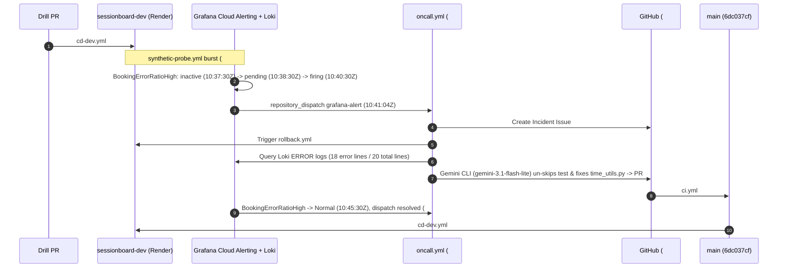

# End-to-End Chaos Drill & Autonomous On-Call Demo (Phase 9)

This document records the live end-to-end **Phase 9 Chaos Drill** executed against `sessionboard-dev` (`https://sessionboard-dev.onrender.com`) and **Grafana Cloud** (`https://dashingamaranth3073.grafana.net`) on **2026-11-14**, proving automated detection, rollback mitigation, headless AI root-cause remediation, CI verification, auto-merge, recovery deployment, and alert resolution without human code intervention.

---

## 1. Pre-Drill Setup & Dry-Run Verification

- **Grafana Cloud Contact Point:** `github-oncall-dispatch` (`uid: github-oncall-dispatch`), configured with `ops/grafana/contact-point-payload.tmpl` to POST `event_type: grafana-alert` via GitHub `repository_dispatch` to `brut0/sessionboard`.
- **Grafana Cloud Alert Rule:** `BookingErrorRatioHigh` (`uid: ag49ldardj6dce`, folder `sessionboard-alerts`, rule group `sessionboard-sli`), evaluating `$B >= 3 && ($A / $B) > 0.2` over a 5-minute window (`intervalSeconds: 60`, `for: 2m`).
- **Notification Pipeline Dry-Run:** Tested the webhook directly via Grafana's receiver `/test` endpoint (`HTTP 200`, `427ms`), triggering [`oncall.yml` #43584182941](https://github.com/brut0/sessionboard/actions/runs/43584182941) (`success`). During that dry-run, `gemini-2.5-flash` hit its daily free-tier cap and `.github/workflows/oncall.yml`'s fallback chain succeeded cleanly on `gemini-3.1-flash-lite`; repository variable `GEMINI_MODEL` was subsequently updated to `gemini-3.1-flash-lite`, and the dry-run artifacts (`#44`, PR `#45`) were closed cleanly before starting the live drill.

---

## 2. Live Chaos Drill Timeline (`2026-11-14` UTC)

| Step | Timestamp (UTC) | Component / Artifact | Observed Result |
|---|---|---|---|
| **1. Baseline Healthy** | `10:31` | `sessionboard-dev` @ `3b3cb8f` | `BookingErrorRatioHigh` `state=inactive`, `health=ok`; zero open `incident` issues |
| **2. Drill Injection** | `10:33:23Z` | [`PR #47`](https://github.com/brut0/sessionboard/pull/47) (`drill/minute-overflow`, [`ci.yml` #43585717930](https://github.com/brut0/sessionboard/actions/runs/43585717930)) | Introduced `datetime.time` overflow on working-hours `:45` start times in `backend/app/domain/time_utils.py` and marked `test_end_minutes_no_overflow` `@pytest.mark.skip(reason="flaky")`; merged as `9a7dd8f2b5078034f5e7098c106faa0bf9d3ac4c` |
| **3. Broken Dev Deploy** | `10:33:25Z` – `10:36:49Z` | [`cd-dev.yml` #43585843607](https://github.com/brut0/sessionboard/actions/runs/43585843607) | Deployed `9a7dd8f` to Render Dev and failed at `Run synthetic smoke probe` on `:45+30m` booking slots (`conclusion: failure`) |
| **4. Burst Probe** | `10:37:10Z` | [`synthetic-probe.yml` #43586140601](https://github.com/brut0/sessionboard/actions/runs/43586140601) | Dispatched `--mode burst` against `sessionboard-dev`, sending repeating valid + `:45+30m` bookings to feed `sessionboard_bookings_total` and Loki error logs |
| **5. Alert Evaluation** | `10:37:30Z` → `10:40:30Z` | Grafana Rule `BookingErrorRatioHigh` (`ag49ldardj6dce`) | Transitioned `inactive` (`10:37:30Z`) → `pending` (`10:38:30Z`) → `firing` (`10:40:30Z`) |
| **6. On-Call Triggered** | `10:41:04Z` | [`oncall.yml` #43586436665](https://github.com/brut0/sessionboard/actions/runs/43586436665) | Triggered via `repository_dispatch` (`grafana-alert`); completed cleanly in **2m 29s** (`success`) |
| **7. Incident Created** | `10:41:12Z` | [Issue `#48`](https://github.com/brut0/sessionboard/issues/48) | `[incident] BookingErrorRatioHigh on dev` opened automatically |
| **8. Deterministic Rollback** | `10:41:17Z` – `10:42:44Z` | [`rollback.yml` #43586452777](https://github.com/brut0/sessionboard/actions/runs/43586452777) | Rolled `sessionboard-dev` back to healthy SHA `3b3cb8f9cc36719195a280c272f942dacc937b3f` (`success`), restoring service availability before code diagnosis finished |
| **9. Loki + Gemini CLI Fix** | `10:41:23Z` – `10:43:16Z` | `oncall-agent` (`gemini-3.1-flash-lite`, commit `5b40edd`) | Queried Grafana Cloud Loki (`status=200`, `error_lines_30m=18`, `total_lines_60m=20`, zero PII); restored integer `start_minutes + duration_minutes` math in `backend/app/domain/time_utils.py` and re-enabled `test_end_minutes_no_overflow` (`49 passed` + `ruff` green) |
| **10. Auto-Merging Fix PR** | `10:43:24Z` – `10:44:44Z` | [`PR #49`](https://github.com/brut0/sessionboard/pull/49) (`oncall/incident-48`, [`ci.yml` #43586622025](https://github.com/brut0/sessionboard/actions/runs/43586622025)) | CI passed cleanly; GitHub squash auto-merge landed `6dc037cf4263f179ceb6817936c1dee321c080f9` (`10:44:42Z`) and automatically closed Issue `#48` (`10:44:44Z`) |
| **11. Alert Resolved** | `10:45:30Z` → `10:46:11Z` | [`oncall.yml` #43586823690](https://github.com/brut0/sessionboard/actions/runs/43586823690) | Grafana returned `BookingErrorRatioHigh` to `inactive` (`Normal`) and sent `resolved` webhook (`Comment Alert Resolved`: `success`, noting `#48` was already closed) |
| **12. Recovery Deploy** | `10:44:45Z` – `10:47:57Z` | [`cd-dev.yml` #43586718427](https://github.com/brut0/sessionboard/actions/runs/43586718427) | Built & deployed `6dc037cf4263f179ceb6817936c1dee321c080f9` to Render Dev (`success`); live `/api/version` confirmed `6dc037cf` and `synthetic_probe.py --mode once` exited `0` (`total=3, 2xx=3, 4xx=0, 5xx=0, cancel_failed=0`) |

---

## 3. Agent Fix Diff Summary ([`PR #49`](https://github.com/brut0/sessionboard/pull/49))

Commit `5b40eddce0a94c74929a3e92a9f56b8a874cc0f6` (`Agent: oncall-agent`, `Refs: #48`):
- **`backend/app/domain/time_utils.py`:** Removed the faulty `datetime.time` addition branch on `:45` working-hour bookings and restored pure integer minute arithmetic (`return start_minutes + duration_minutes`).
- **`backend/tests/unit/test_time_utils.py`:** Removed `@pytest.mark.skip(reason="flaky")` from `test_end_minutes_no_overflow`, ensuring CI immediately fails on any future regression across hour boundaries.

---

## 4. Audit Links & Reproducibility Note

- **Incident Issue:** [`https://github.com/brut0/sessionboard/issues/48`](https://github.com/brut0/sessionboard/issues/48)
- **Automated Fix PR:** [`https://github.com/brut0/sessionboard/pull/49`](https://github.com/brut0/sessionboard/pull/49)
- **On-Call Execution Log (`firing`):** [`https://github.com/brut0/sessionboard/actions/runs/43586436665`](https://github.com/brut0/sessionboard/actions/runs/43586436665)
- **On-Call Resolution Webhook (`resolved`):** [`https://github.com/brut0/sessionboard/actions/runs/43586823690`](https://github.com/brut0/sessionboard/actions/runs/43586823690)
- **Rollback Mitigation Run:** [`https://github.com/brut0/sessionboard/actions/runs/43586452777`](https://github.com/brut0/sessionboard/actions/runs/43586452777)
- **Recovery Deployment Run:** [`https://github.com/brut0/sessionboard/actions/runs/43586718427`](https://github.com/brut0/sessionboard/actions/runs/43586718427)
- **Video / Media Note:** No binary screencast video was committed to Git in this drill; every stage is auditable directly through the linked immutable GitHub Issues, PR diffs, and GitHub Actions logs above.
