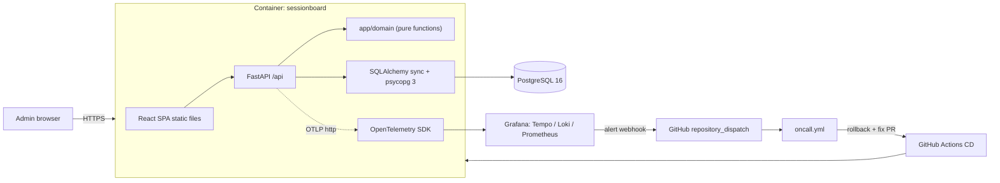

# SessionBoard — Master Plan

> **For agentic workers:** This is the single source of truth for HOW the project is built.
> `specs/` (created in Phase 1–2) is the source of truth for WHAT is built.
> Work phase by phase (§14). Never start a phase before the previous phase's **Gate** passes.
> If this plan and a spec disagree, stop and ask the human. Do not improvise around the plan.
> Everything committed to this repository is written in **English only**.

---

## 1. Fixed decisions

| Topic | Decision |
|---|---|
| Product | **SessionBoard** — a tiny web app for a small studio (tutors, coaches, therapists) to book sessions on a daily board without double bookings |
| Course | AI Dev Tools Zoomcamp 2026, final project. Criteria: https://github.com/DataTalksClub/ai-dev-tools-zoomcamp/tree/main/project |
| Target score | 22–24 of 24 (pass = 10) |
| Backend | Python **3.12**, FastAPI, SQLAlchemy **2.x sync** ORM, **psycopg 3** (`psycopg[binary]`), Alembic, pydantic-settings, `uv` |
| Why sync | Tiny app; sync avoids Windows event-loop issues with async psycopg and keeps tests simple (`TestClient`) |
| Database | PostgreSQL **16** (local: `postgres:16-alpine` container; cloud: Neon, one project per environment) |
| Frontend | React 19 + Vite + TypeScript + Tailwind CSS. No router (two tabs via state). Types generated from OpenAPI (`openapi-typescript`), requests via `openapi-fetch` |
| Tests | pytest (unit + integration with **testcontainers** Postgres), Vitest + React Testing Library + MSW |
| Container | One multi-stage `Dockerfile` (Node builds SPA → Python runtime serves API + static SPA) |
| Local run | `docker compose up --build` (alias `make up`): `db` + `app` + `otel-lgtm` (Grafana, Tempo, Loki, Prometheus all-in-one) |
| Registry | GHCR `ghcr.io/<owner>/sessionboard:<git-sha>` (package visibility: **public**) |
| Hosting | Render free web services `sessionboard-dev` and `sessionboard-prod`, type **Existing Image** |
| Telemetry backend (cloud) | Grafana Cloud free stack via OTLP gateway |
| CI/CD | GitHub Actions: CI on PR → auto deploy to dev on merge → manual deploy to prod with environment approval → rollback workflow |
| Alert | Grafana Cloud alert on booking error ratio (user impact) |
| On-call agent | Grafana webhook → GitHub `repository_dispatch` → `oncall.yml` → rollback + Gemini CLI (headless) fix → PR → auto-merge after CI |
| Tracker | Public GitHub Issues + public GitHub Project board |
| Out of scope (forever) | Free-slot finder, solver/auto-scheduling, recurring templates, pricing/finance, absences, messengers, Excel import, auth, multi-tenancy, i18n |

---

## 2. Course criteria → deliverables → evidence

| # | Criterion (pts) | Deliverable | Evidence linked from README |
|---|---|---|---|
| 1 | Problem description (2) | README sections Problem / Features / Expected behavior | `README.md` |
| 2 | Product specification (2) | `specs/product-spec.md` with ACs + public Issues/Project; agents comment on issues; PRs `Closes #N` | spec, board link, closed issues |
| 3 | Agent team (2) | `docs/agents/team.md`, `.agents/roles/*.md`, labels `agent:*` | those files, issue history |
| 4 | Context management (2) | `AGENTS.md` → modular docs (process, team, architecture, testing, deployment, observability, runbooks) | `AGENTS.md` |
| 5 | Application (2) | FE ↔ BE ↔ Postgres, one command | `docker compose up --build`, GIF |
| 6 | Testing (2) | unit + integration (+ frontend), one command, green | `make test`, CI badge |
| 7 | Containerization (2) | compose with db, one command | `docker-compose.yml` |
| 8 | Deployment (2) | dev + prod public URLs | README links |
| 9 | CI/CD (3) | `ci.yml`, `cd-dev.yml`, `deploy-prod.yml` (manual + approval), `rollback.yml` | Actions tab, `docs/deployment.md` |
| 10 | Observability (2) | journey "Book a session": traces + metrics + structured logs sharing `trace_id`, no PII, viewable in Grafana | `docs/observability.md` with screenshots |
| 11 | Alerting (1) | Grafana alert rule on booking error ratio | `ops/grafana/alert-rule.json`, screenshot |
| 12 | On-call agent (2) | `oncall.yml` wakes on alert, rolls back, opens fix PR | incident issue + agent PR, `docs/oncall-demo.md` |

Priority if time runs short: Phases 0–7 (≈19 pts) before Phases 8–9.

---

## 3. Product scope

### 3.1 Problem (README wording base)
Small studios with 2–5 rooms and a handful of specialists schedule sessions in spreadsheets or chats.
Double bookings happen: the same specialist, room, or client ends up in two overlapping sessions.
SessionBoard is a tiny web app where an administrator books sessions on a daily board, and the system
refuses any booking that conflicts.

### 3.2 User
One persona: **studio administrator**. No authentication (documented non-goal; the public demo uses synthetic data only).

### 3.3 Features
| ID | Feature |
|---|---|
| F1 | Directory: list / create / delete specialists, clients, rooms |
| F2 | Book a session with conflict detection (specialist, room, client) |
| F3 | Day board: one column per room, sessions of the selected date, previous/next day navigation |
| F4 | Status change: `planned → done`, `planned → cancelled`; cancelled sessions never cause conflicts |

### 3.4 Business rules (copy verbatim into `specs/product-spec.md`)
- BR-1 Working hours are 08:00–20:00 local studio time. A session must start at or after 08:00 and end at or before 20:00. No time zones are stored or converted.
- BR-2 `start_time` minutes ∈ {00, 15, 30, 45}. `duration_minutes` ∈ {15, 30, …, 180}.
- BR-3 Two sessions overlap when they are on the same date and `[start, end)` intervals intersect. Touching intervals (one ends exactly when the other starts) do **not** overlap.
- BR-4 A new session conflicts with an existing session when they overlap, the existing session's status is not `cancelled`, and they share the specialist, the room, or the client. All conflicts are reported, one entry per (type, existing session).
- BR-5 Status transitions: only `planned → done` and `planned → cancelled`. Any other transition is rejected.
- BR-6 A specialist, client, or room that has at least one `planned` session cannot be deleted.
- BR-7 Room names are unique (case-sensitive).
- BR-8 Concurrent bookings for the same date are serialized (Postgres transaction-scoped advisory lock keyed by the date), so two simultaneous requests cannot both create conflicting sessions.

### 3.5 Error contract
| Situation | HTTP | Body |
|---|---|---|
| Schema / BR-1 / BR-2 violation | 422 | FastAPI default validation body |
| Referenced specialist/client/room or session id does not exist | 404 | `{"detail": "not_found"}` |
| Booking conflicts (BR-4) | 409 | `{"detail": "conflict", "conflicts": [{"type": "specialist" \| "room" \| "client", "session_id": 12}]}` |
| Invalid status transition (BR-5) | 409 | `{"detail": "invalid_status_transition"}` |
| Delete blocked (BR-6) | 409 | `{"detail": "has_planned_sessions"}` |
| Duplicate room name (BR-7) | 409 | `{"detail": "room_name_taken"}` |
| Unexpected error | 500 | `{"detail": "internal_error", "trace_id": "<32 hex>"}` |

---

## 4. Data model (exact)

| Table | Columns |
|---|---|
| `specialists` | `id` int PK identity · `name` varchar(100) not null · `specialty` varchar(100) not null · `created_at` timestamptz not null default now() |
| `clients` | `id` int PK identity · `display_name` varchar(100) not null · `created_at` timestamptz |
| `rooms` | `id` int PK identity · `name` varchar(50) not null **unique** · `created_at` timestamptz |
| `sessions` | `id` int PK identity · `specialist_id` FK→specialists RESTRICT · `client_id` FK→clients RESTRICT · `room_id` FK→rooms RESTRICT · `session_date` date not null · `start_time` time not null · `duration_minutes` int not null CHECK (between 15 and 180 and % 15 = 0) · `status` varchar(16) not null default 'planned' CHECK in ('planned','done','cancelled') · `created_at`, `updated_at` timestamptz |

Indexes on `sessions`: (`session_date`, `room_id`), (`session_date`, `specialist_id`), (`session_date`, `client_id`).
All string inputs are trimmed; empty after trim → 422. Schema is managed **only** by Alembic (`0001_initial`); never call `create_all` in the app.

---

## 5. API contract (draft for `specs/api/openapi.yaml`)

Base path `/api`. JSON only. Path parameter names are exactly as below (FastAPI must match the YAML).

| Method | Path | Request | Success | Errors |
|---|---|---|---|---|
| GET | `/api/health` | — | 200 `{"status":"ok","db":"ok"}` (503 `{"status":"degraded","db":"error"}` if DB unreachable) | 503 |
| GET | `/api/version` | — | 200 `{"version":"<git sha>","env":"local\|dev\|prod"}` | — |
| GET | `/api/specialists` | — | 200 `Specialist[]` sorted by name | — |
| POST | `/api/specialists` | `{"name","specialty"}` | 201 `Specialist` | 422 |
| DELETE | `/api/specialists/{specialist_id}` | — | 204 | 404, 409 |
| GET | `/api/clients` | — | 200 `Client[]` sorted by display_name | — |
| POST | `/api/clients` | `{"display_name"}` | 201 `Client` | 422 |
| DELETE | `/api/clients/{client_id}` | — | 204 | 404, 409 |
| GET | `/api/rooms` | — | 200 `Room[]` sorted by name | — |
| POST | `/api/rooms` | `{"name"}` | 201 `Room` | 409, 422 |
| DELETE | `/api/rooms/{room_id}` | — | 204 | 404, 409 |
| GET | `/api/sessions?date=YYYY-MM-DD` | — | 200 `Session[]` (all statuses) sorted by room_id, start_time | 422 |
| POST | `/api/sessions` | `SessionCreate` | 201 `Session` | 404, 409, 422 |
| PATCH | `/api/sessions/{session_id}` | `{"status":"done"\|"cancelled"}` | 200 `Session` | 404, 409, 422 |

Schemas:
- `Specialist {id:int, name:str, specialty:str}` · `Client {id:int, display_name:str}` · `Room {id:int, name:str}`
- `SessionCreate {specialist_id:int, client_id:int, room_id:int, session_date:date, start_time:str "HH:MM" pattern ^([01]\d|2[0-3]):[0-5]\d$, duration_minutes:int}`
- `Session {id, specialist_id, specialist_name, client_id, client_display_name, room_id, room_name, session_date, start_time "HH:MM", end_time "HH:MM", duration_minutes, status}`
- `ConflictItem {type: enum, session_id:int}` · `ConflictError {detail:"conflict", conflicts: ConflictItem[]}` · `ErrorDetail {detail:str}`

Contract rules:
1. `specs/api/openapi.yaml` is written **before** endpoint code and changed **before** any API change.
2. Backend test `tests/integration/test_openapi_contract.py`: the set of (path, method) in `app.openapi()` equals the YAML's set, and for each operation the set of response status codes is equal. Use `responses={...}` in route decorators for 404/409/503. The YAML must list 422 wherever FastAPI adds it.
3. Frontend: `npm run gen:api` = `openapi-typescript ../specs/api/openapi.yaml -o src/api/schema.d.ts`. The generated file is committed; CI regenerates it and fails on `git diff --exit-code`.

---

## 6. Architecture and implementation rules



### 6.1 Repository layout (target)
```
AGENTS.md  README.md  Makefile  Dockerfile  docker-compose.yml  .gitattributes  .gitignore
specs/        constitution.md  product-spec.md  data-model.md  nfr-observability.md  tasks.md  api/openapi.yaml
docs/         architecture.md  process.md  testing.md  deployment.md  observability.md  ai-tools.md
              oncall-demo.md  agents/team.md  runbooks/booking-errors.md  adr/000N-*.md  plan/*.md
.agents/      roles/*.md  skills/*/SKILL.md
.github/      ISSUE_TEMPLATE/task.yml  pull_request_template.md  workflows/*.yml
backend/      pyproject.toml  uv.lock  alembic.ini  alembic/  docker-entrypoint.sh
              app/main.py  app/config.py  app/db.py  app/models.py  app/schemas.py
              app/telemetry.py  app/logging_config.py  app/seed.py
              app/domain/time_utils.py  app/domain/conflicts.py
              app/api/directory.py  app/api/sessions.py  app/api/system.py
              tests/conftest.py  tests/unit/  tests/integration/
frontend/     package.json  vite.config.ts  src/{main.tsx, App.tsx, api/, pages/, components/, utils/}
ops/grafana/  dashboard.json  alert-rule.json  contact-point-payload.tmpl
scripts/      check_repo_hygiene.py  synthetic_probe.py
```

### 6.2 Backend rules
- `app/config.py` (pydantic-settings): `DATABASE_URL` (required), `APP_ENV` (`local|dev|prod|test`, default `local`), `APP_VERSION` (default `unknown`), `SEED_DEMO_DATA` (bool, default false). OTel is configured by standard `OTEL_*` env vars.
- `app/db.py` normalizes `DATABASE_URL`: `postgres://` or `postgresql://` → `postgresql+psycopg://`; all query params (e.g. Neon `sslmode=require&channel_binding=require`) are kept — psycopg/libpq supports them.
- Domain layer has no ORM/FastAPI imports: `time_utils.py` (`to_minutes(hhmm) -> int`, `to_hhmm(minutes) -> str`, `end_minutes(start, duration) -> int`) and `conflicts.py` (`find_conflicts(new: Slot, existing: list[Slot]) -> list[Conflict]` with frozen dataclasses). All time math is done in **minutes since midnight** — never `datetime.time(...)` arithmetic.
- Booking flow in `POST /api/sessions`: validate → open transaction → `SELECT pg_advisory_xact_lock(hashtext(CAST(:date_str AS text)))` → verify referenced ids exist (404) → load non-cancelled sessions of that date sharing specialist/room/client → `find_conflicts` → 409 or insert → commit.
- Startup: `docker-entrypoint.sh` runs `uv run alembic upgrade head`, then `uv run python -m app.seed` (idempotent; only when `SEED_DEMO_DATA=true` and all tables are empty), then `exec uv run uvicorn app.main:app --host 0.0.0.0 --port ${PORT:-8000}`. Render injects `PORT`; free plan has no pre-deploy command, so migrations run here.
- Static SPA is served from `app/static` (copied in Docker build): `/assets/*` via StaticFiles, `GET /` and any non-`/api` GET → `index.html`.
- Every response carries header `X-Trace-Id` (current trace id, 32 hex). 500 handler returns `{"detail":"internal_error","trace_id":...}`.
- Seed data is synthetic only: specialists `Alex Morgan (Math tutor)`, `Sam Lee (Guitar coach)`, `Jordan Park (Speech coach)`; rooms `Room A`, `Room B`, `Room C`; clients `Client 01`…`Client 08`; ~6 sessions on the current date.
- Lint: `ruff check` + `ruff format --check`. mypy optional (not a gate).

### 6.3 Frontend rules
- Same-origin `/api` in production; Vite dev server proxies `/api` → `http://localhost:8000`.
- Tabs: **Day Board** (default) and **Directory**.
- Day Board: date input (default today), "◀ Prev" / "Today" / "Next ▶", one column per room, cards show `HH:MM–HH:MM`, specialist, client, status badge; buttons **Done** / **Cancel** on planned cards; **New session** opens BookingModal; cancelled cards are greyed.
- BookingModal: selects for specialist / client / room; date; start time options 08:00…19:45 step 15; duration options 15…180 step 15; on 409 render one line per conflict: "Specialist is busy (session #12)", "Room is busy …", "Client is busy …"; on 5xx render "Something went wrong. Trace ID: <id>" using `X-Trace-Id`.
- Directory: three cards (Specialists, Clients, Rooms) each with list, add form, delete button; 409 shows "Cannot delete: has planned sessions" / "Room name already exists".
- `data-testid` attributes on interactive elements used by tests.

---

## 7. Testing strategy

| Layer | Location | Tooling | Must cover |
|---|---|---|---|
| Unit | `backend/tests/unit/` | pytest | `time_utils` (incl. minute overflow e.g. 10:45+30 = 11:15), `find_conflicts` table-driven: no overlap, touching, partial, contained, each type, multiple types, cancelled ignored; BR-1/BR-2 validators |
| Integration | `backend/tests/integration/` (`@pytest.mark.integration`) | pytest + FastAPI `TestClient` + testcontainers `PostgresContainer("postgres:16-alpine", driver="psycopg")`, Alembic upgrade once per session, truncate tables per test | **one test per AC**, named `test_ac_<story>_<n>_<slug>`; contract test; no-PII telemetry test |
| Frontend | `frontend/src/**/*.test.tsx` | Vitest + jsdom + RTL + MSW | DayBoard groups sessions by room; Done/Cancel calls PATCH and updates card; BookingModal renders conflict lines on 409; Directory shows 409 delete error |

Commands (identical on Windows/Linux; Docker must be running for integration tests):
- `make test` → `make test-backend test-frontend`
- `make test-backend` → `cd backend && uv run pytest`
- `make test-frontend` → `cd frontend && npm test` (where `"test": "vitest run"`)
- `make lint` → `cd backend && uv run ruff check . && uv run ruff format --check .` and `cd frontend && npm run typecheck`

Tests set `OTEL_SDK_DISABLED=true` except the no-PII test, which installs in-memory span/log exporters.

---

## 8. Containerization

`docker-compose.yml` services:
| Service | Image | Ports | Notes |
|---|---|---|---|
| `db` | `postgres:16-alpine` | none published | `POSTGRES_USER/PASSWORD/DB=sessionboard`, volume `pgdata`, healthcheck `pg_isready` |
| `app` | build `.` | `8000:8000` | `depends_on: db (service_healthy)`, env `DATABASE_URL=postgresql://sessionboard:sessionboard@db:5432/sessionboard`, `APP_ENV=local`, `SEED_DEMO_DATA=true`, `OTEL_SERVICE_NAME=sessionboard`, `OTEL_EXPORTER_OTLP_ENDPOINT=http://otel-lgtm:4318`, `OTEL_EXPORTER_OTLP_PROTOCOL=http/protobuf` |
| `otel-lgtm` | `grafana/otel-lgtm` | `3000:3000` | Grafana UI (admin/admin); OTLP 4317/4318 internal |

Dockerfile: stage 1 `node:22-alpine` (`npm ci`, `npm run build`); stage 2 `python:3.12-slim` with `COPY --from=ghcr.io/astral-sh/uv:latest /uv /uvx /bin/`, `uv sync --frozen --no-dev`, copy app + alembic + SPA dist to `app/static`, `ARG GIT_SHA=unknown` → `ENV APP_VERSION=$GIT_SHA`, `HEALTHCHECK` on `/api/health`, `ENTRYPOINT ["/app/backend/docker-entrypoint.sh"]`. Build for `linux/amd64`.
`.gitattributes` must contain `* text=auto eol=lf` (a CRLF entrypoint script breaks the container).

---

## 9. Environments, CI/CD, rollback

| Env | URL | DB | Deployed by |
|---|---|---|---|
| local | http://localhost:8000 | compose `db` | `docker compose up --build` |
| dev | `https://sessionboard-dev.onrender.com` (actual name may differ) | Neon project `sessionboard-dev` | `cd-dev.yml` on every push to `main` |
| prod | `https://sessionboard-prod.onrender.com` | Neon project `sessionboard-prod` | `deploy-prod.yml`, manual, environment `production` requires owner approval |

Workflows:
| File | Trigger | Steps |
|---|---|---|
| `ci.yml` | `pull_request` to main, `workflow_call` | jobs: `hygiene` (`python scripts/check_repo_hygiene.py`, secret `FORBIDDEN_TERMS`), `backend` (setup-uv, `uv sync --frozen`, ruff, `uv run pytest`), `frontend` (node 22, `npm ci`, `npm run gen:api` + `git diff --exit-code`, typecheck, `npm test`, `npm run build`), `docker` (build only) |
| `cd-dev.yml` | `push` to main | `uses: ./.github/workflows/ci.yml` → build & push `ghcr.io/<owner>/sessionboard:${{ github.sha }}` with `--build-arg GIT_SHA` → `curl -fsS -X POST "${RENDER_DEPLOY_HOOK_DEV}&imgURL=<url-encoded image>"` (note: `RENDER_DEPLOY_HOOK_DEV` already contains `?key=...`, so append with `&imgURL=`) → poll `GET /api/version` until `version == github.sha` (timeout 10 min; cold start ~1 min) → smoke: health + create/cancel a booking via `scripts/synthetic_probe.py --mode once` |
| `deploy-prod.yml` | `workflow_dispatch` input `sha` (required) | `environment: production` → `docker manifest inspect` image exists → prod deploy hook with `imgURL` → poll version → read-only smoke (health, list sessions) |
| `rollback.yml` | `workflow_dispatch` inputs `env` (dev\|prod), `sha` (required) | same as deploy for the given env (prod uses `environment: production`); writes the rollback to the job summary |
| `synthetic-probe.yml` | `schedule: "0 * * * *"` + `workflow_dispatch` input `mode` (once\|burst) | runs `scripts/synthetic_probe.py --base-url $DEV_URL --mode ...` |
| `oncall.yml` | `repository_dispatch` types `[grafana-alert]` | see §12 |

Image URL encoding for Render: `ghcr.io/<owner>/sessionboard:<sha>` → `ghcr.io%2F<owner>%2Fsessionboard%3A<sha>`. The hook's repo must match the service's configured image; only the tag changes. `<owner>` must be lowercase in image names (`${GITHUB_REPOSITORY_OWNER,,}`).
Bootstrap order: Render needs an existing image to create a service, so the deploy/poll/smoke steps of `cd-dev.yml` are skipped with a `::warning::` while `RENDER_DEPLOY_HOOK_DEV` is empty; the first run only pushes the image.
Rollback target = previous commit on main whose image exists: start from `git rev-parse <current_sha>^1`, walk back up to 5 first-parent commits checking `docker manifest inspect`.
Migrations must be backward compatible (expand → migrate → contract) so rollback never needs a down-migration. Documented in `docs/deployment.md`.

Repository settings (Phase 6–7): branch protection on `main` (require PR, require checks `hygiene`, `backend`, `frontend`, `docker`), "Allow auto-merge" ON, environment `production` with required reviewer = owner.

Secrets: `FORBIDDEN_TERMS`, `RENDER_DEPLOY_HOOK_DEV`, `RENDER_DEPLOY_HOOK_PROD`, `GEMINI_API_KEY`, `ONCALL_GH_TOKEN`, `GRAFANA_LOGS_URL`, `GRAFANA_LOGS_USER`, `GRAFANA_LOGS_TOKEN`. Variables: `DEV_URL`, `PROD_URL`, `GEMINI_MODEL`.

---

## 10. Observability

Key user journey: **Book a session** (`POST /api/sessions`).

- `app/telemetry.py`: TracerProvider + MeterProvider + LoggerProvider with OTLP/HTTP exporters, resource `service.name=sessionboard`, `service.version=APP_VERSION`, `deployment.environment=APP_ENV`. Instrument FastAPI (`opentelemetry-instrumentation-fastapi`), SQLAlchemy (`opentelemetry-instrumentation-sqlalchemy`) and logging. Disabled when `OTEL_SDK_DISABLED=true`.
- Span `booking.create` (child of the HTTP server span) with attributes: `booking.result` (`created|conflict|not_found|invalid|error`), `booking.conflict_types` (sorted comma list), `booking.duration_minutes`, `booking.room_id`, `booking.specialist_id`. IDs and enums only. To ensure `invalid` (422) and `error` (500) are captured on the span and metric `sessionboard_bookings_total{result,env}`, register custom FastAPI exception handlers for `RequestValidationError` (when path is `/api/sessions` and method is `POST`, increment metric with `result="invalid"`) and `Exception` (increment metric with `result="error"` and return 500 with `trace_id`).
- Metrics (attribute `result` + `env` only — low cardinality, Grafana free tier = 10k series):
  - counter `sessionboard.bookings` → Prometheus `sessionboard_bookings_total{result,env}`
  - histogram `sessionboard.booking.duration` (unit `s`) → `sessionboard_booking_duration_seconds_*`
- Logs: JSON lines on stdout **and** exported via OTLP. Fields: `ts`, `level`, `logger`, `event`, `msg`, `trace_id`, `span_id`, `env`, `http.route`, `http.status_code`, `booking.result`. One `booking.completed` log per booking.
- PII policy: never record names, display names, request bodies, headers, or connection strings in spans, metrics, or logs. Test `test_telemetry_no_pii.py` books with `display_name="PII-CANARY-7731"` and asserts the canary is absent from all exported spans and log records.
- Local: Grafana at http://localhost:3000 → Explore → Tempo (trace by `X-Trace-Id`) → "Logs for this span" (Loki) → metrics in Prometheus.
- Cloud: `OTEL_EXPORTER_OTLP_ENDPOINT=https://otlp-gateway-prod-<zone>.grafana.net/otlp`, `OTEL_EXPORTER_OTLP_PROTOCOL=http/protobuf`, `OTEL_EXPORTER_OTLP_HEADERS=Authorization=Basic%20<base64(instanceId:token)>` (space must be `%20`).
- `ops/grafana/dashboard.json`: booking rate by result, error ratio, p95 latency.
- `docs/observability.md`: screenshots showing the **same trace id** in a trace, its logs, and the metric panel.

---

## 11. Alerting

Grafana Cloud alert rule `BookingErrorRatioHigh` (exported to `ops/grafana/alert-rule.json`):
- A = `sum(increase(sessionboard_bookings_total{env="dev",result="error"}[5m]))`
- B = `sum(increase(sessionboard_bookings_total{env="dev"}[5m]))`
- Condition: `B >= 3 AND A / B > 0.2`; evaluate every 1m; pending period 2m; **No data → Normal**; labels `service=sessionboard`, `env=dev`, `severity=page`; annotation `summary`, `runbook_url` → `docs/runbooks/booking-errors.md`.
- Rationale: errors (5xx) are what users feel; 409/422 are correct behavior and are excluded. Thresholds tuned for low synthetic traffic; production values documented separately in `specs/nfr-observability.md` (SLO 99% successful bookings over 7 days).

Contact point `github-oncall` (Webhook): URL `https://api.github.com/repos/<owner>/sessionboard/dispatches`, method POST, Authorization `Bearer <ONCALL dispatch PAT>`, extra headers `Accept: application/vnd.github+json`, `X-GitHub-Api-Version: 2022-11-28`, custom payload from `ops/grafana/contact-point-payload.tmpl`:
```
{"event_type":"grafana-alert","client_payload":{"status":"{{ .Status }}","alertname":"{{ .CommonLabels.alertname }}","env":"{{ .CommonLabels.env }}","summary":"{{ .CommonAnnotations.summary }}"}}
```
Fallback if custom payload is unavailable: a ~20-line Cloudflare Worker relay that reshapes Grafana's JSON into the format above.

---

## 12. On-call agent (`oncall.yml`)

Trigger `repository_dispatch: types: [grafana-alert]`; `concurrency: oncall` (no cancel). Permissions: contents/issues/pull-requests/actions write.

If `client_payload.status == "firing"`:
1. Checkout with `token: ${{ secrets.ONCALL_GH_TOKEN }}` and `fetch-depth: 0`. (Pushes/PRs made with the default `GITHUB_TOKEN` do **not** trigger CI; `ONCALL_GH_TOKEN` is a fine-grained PAT for this repo only: Contents RW, Pull requests RW, Issues RW, Actions RW.)
2. Create incident issue: title `[incident] BookingErrorRatioHigh on dev`, labels `incident,oncall,agent:oncall`, body = payload + timestamp.
3. Read current dev version from `${DEV_URL}/api/version`; compute rollback target (§9); `gh workflow run rollback.yml -f env=dev -f sha=<target>` (allowed with `GITHUB_TOKEN`); comment on issue.
4. Collect evidence into `incident/` (not committed): Loki query `{service_name="sessionboard"} | json | level="ERROR"` for the last 30 min via `GRAFANA_LOGS_*` (max 200 lines; continue if it fails), `git log -5 --stat`, `git diff <target>..<current> -- backend frontend`.
5. Run the agent: setup-uv + Node 22, then run `google-github-actions/run-gemini-cli@v0` (or `npx -y @google/gemini-cli@latest --yolo -m "$GEMINI_MODEL" -p "$(cat .agents/roles/oncall.md docs/runbooks/booking-errors.md incident/context.md)"` with `GEMINI_API_KEY` and `GEMINI_CLI_TRUST_WORKSPACE=true`). The prompt requires: write a failing regression test, fix the code, run `cd backend && uv run pytest`, touch only `backend/` files.
6. Deterministic verification (not the LLM): `cd backend && uv run pytest` must pass and `git diff --stat` must be non-empty; otherwise comment "Mitigated by rollback; automatic fix failed; human needed" and stop.
7. Branch `oncall/incident-<n>`, commit `fix: <summary>` with trailers `Agent: oncall-agent` and `Refs: #<n>`, push, `gh pr create --label oncall --body "Closes #<n> …"`, `gh pr merge --auto --squash`. CI runs; on green the PR merges and `cd-dev.yml` deploys the fix.

If `status == "resolved"`: comment "Alert resolved at <time>" on the open incident issue.

Why Gemini CLI: free API key from Google AI Studio (no card), one secret, headless `-p` + `--yolo` mode. Free tier is Flash-class models with daily limits — enough for one small fix. Set repo variable `GEMINI_MODEL` to the current free Flash model name shown in AI Studio.

### 12.1 Chaos drill (demo, `docs/oncall-demo.md`)
1. Dev healthy, alert Normal.
2. Human opens PR from `drill/minute-overflow` labelled `drill`: replaces minutes-based end-time calculation with `datetime.time(start.hour, start.minute + duration)` (raises `ValueError` when minutes ≥ 60 → 500) and marks the covering tests `@pytest.mark.skip(reason="flaky")` — simulating a careless change that passes CI. Human merges.
3. `cd-dev.yml` deploys. Run `synthetic-probe.yml` with `mode=burst` (one booking every 10 s for 15 min; every third booking starts at :45 with 30 min).
4. Record (screen video 2–4 min): alert firing → incident issue → rollback run → agent PR (fix + un-skipped tests) → CI green → auto-merge → deploy → alert resolved.

---

## 13. Agent team and process

Defined in `docs/agents/team.md` and `docs/process.md`; role prompts in `.agents/roles/`; procedures in `.agents/skills/`.
Roles: Human (owner), Spec, Architect, Backend, Frontend, QA, Reviewer, DevOps, On-call.
Shared state lives in GitHub Issues — every task is an issue, every change is a PR that closes it.

---

## 14. Phases

Each phase: owner role(s) → steps → **Gate** (command + expected result). Every gate report (format in skill `phase-gate`) is posted as a comment on the pinned issue **"Phase gates log"** created in Phase 0.

### Phase 0 — Bootstrap and hygiene (DevOps, ~1 h)
1. `git init -b main` in the repo root; ensure `.gitignore`, `.gitattributes` (`* text=auto eol=lf`).
2. Human completes `.local/forbidden-terms.txt` (already created, git-ignored; one case-insensitive regex per line; `#` comments and blank lines ignored). `.local/PROTOTYPE_REUSE.md` lists the only prototype files agents may read.
3. Write `scripts/check_repo_hygiene.py` (stdlib only): file list = `git ls-files --cached --others --exclude-standard` (tracked + new, never git-ignored files such as `.local/`; works before the first commit); skip binary files (NUL byte in first 8 KB); also scan all commit messages (`git log --all --format=%B`, skipped when there are no commits). Fails on (a) any Cyrillic character `[\u0400-\u04FF]`, (b) any regex from env `FORBIDDEN_TERMS` (newline-separated, same comment rules) or, if the env var is unset, from `.local/forbidden-terms.txt`; if neither exists, only rule (a) runs and a warning is printed. Prints `file:line` for each hit; never prints the matched term itself in CI logs (print `<redacted>`). Exit 1 on hits. Add as git pre-commit hook via `scripts/install-hooks.sh` / `.ps1`.
4. `gh auth status` (scopes `repo`, `workflow`; `project` is optional). `gh repo create sessionboard --public --source . --remote origin`.
5. Labels: `agent:spec`, `agent:architect`, `agent:backend`, `agent:frontend`, `agent:qa`, `agent:reviewer`, `agent:devops`, `agent:oncall`, `type:feature`, `type:test`, `type:infra`, `type:docs`, `incident`, `oncall`, `drill`, `phase:0`…`phase:10`.
6. Public task tracker: GitHub Issues with `phase:*` and `agent:*` labels + Milestones (`Phase 0-2: Spec & Plan`, `Phase 3-5: Core App & Tests`, `Phase 6-7: CI/CD & Deploy`, `Phase 8-9: Observability & On-Call`, `Phase 10: Docs & Submission`). If the token also has the `project` scope, optionally create a GitHub Project board `SessionBoard`.
7. Add `.github/ISSUE_TEMPLATE/task.yml` and `.github/pull_request_template.md` (§ docs/process.md). Secret `FORBIDDEN_TERMS` = contents of the local file.
8. Create and pin issue `Phase gates log` (`gh issue create --title "Phase gates log" --label type:docs` then `gh issue pin <n>`); post the Phase 0 gate report there.
9. First commit `chore: bootstrap repository` and push.
- **Gate:** `python scripts/check_repo_hygiene.py` → `OK`; repo and board open in a logged-out browser window.

### Phase 1 — Specify (Spec agent → Human, ~2 h)
1. `specs/constitution.md`: stack (§1), principles (KISS, YAGNI, spec-first, TDD, domain without ORM, English only, no PII in telemetry, issue-per-change), global Definition of Done (§17).
2. `specs/product-spec.md`: problem, persona, user stories US1–US4 (F1–F4), business rules BR-1…BR-8 verbatim, error contract (§3.5), ACs in Given/When/Then with IDs `AC-<story>.<n>`, non-goals. Minimum ACs: every BR has ≥1 AC; every error row in §3.5 has ≥1 AC; total ≥ 14.
3. `## Clarifications` section: list ambiguities, resolve using this plan; unresolved → ask human.
4. `specs/nfr-observability.md`: SLI/SLO, telemetry fields (§10), PII policy, alert (§11).
- **Gate:** Human replies "spec approved"; commit `docs(spec): approve v1`. Checklist BR→AC table is complete.

### Phase 2 — Plan and tasks (Architect, ~1.5 h)
1. `specs/data-model.md` (mermaid ER, §4), `specs/api/openapi.yaml` (OpenAPI 3.1, §5), `docs/architecture.md` (§6 diagram + layers + booking sequence diagram), ADRs: `0001-stack.md`, `0002-hosting-and-telemetry.md`, `0003-sync-sqlalchemy.md`.
2. `docs/agents/team.md` and `docs/process.md` already exist — review only.
3. `specs/tasks.md`: tasks T01–T16 below with AC mapping table; create one GitHub issue per task with the template (title `[Txx] …`, labels `agent:*`, `type:*`, `phase:*`). Store issue numbers back into `specs/tasks.md`.
4. Validate YAML: `npx @redocly/cli lint specs/api/openapi.yaml` → no errors.
- **Gate:** every AC appears in at least one task; all issues visible on the board.

| Task | Title | Role | Phase |
|---|---|---|---|
| T01 | Repo skeleton: backend/frontend scaffolds, Makefile, compose, Dockerfile | devops | 3 |
| T02 | DB models, Alembic 0001, seed | backend | 4 |
| T03 | Domain: time utils and conflict detection (unit tests) | backend | 4 |
| T04 | Directory API (F1) | backend | 4 |
| T05 | Sessions API: create/list/status (F2–F4) | backend | 4 |
| T06 | Integration tests per AC + contract test | qa | 4 |
| T07 | Frontend shell, generated client, tabs | frontend | 5 |
| T08 | Day Board + status actions | frontend | 5 |
| T09 | Booking modal with conflict display | frontend | 5 |
| T10 | Directory page | frontend | 5 |
| T11 | Frontend component tests | qa | 5 |
| T12 | CI pipeline + branch protection | devops | 6 |
| T13 | Deploy dev/prod, CD, rollback | devops | 7 |
| T14 | Telemetry: traces, metrics, logs, no-PII test, dashboard | devops + backend | 8 |
| T15 | Alert rule, probe, on-call workflow, runbook, drill | devops + oncall | 9 |
| T16 | README, docs, demo media, submission | spec | 10 |

### Phase 3 — Skeleton (DevOps, T01, ~1.5 h)
1. `backend/`: `uv init --app --python 3.12`; deps `fastapi uvicorn[standard] sqlalchemy psycopg[binary] alembic pydantic-settings opentelemetry-sdk opentelemetry-exporter-otlp-proto-http opentelemetry-instrumentation-fastapi opentelemetry-instrumentation-sqlalchemy opentelemetry-instrumentation-logging`; dev deps `pytest httpx testcontainers[postgres] ruff`.
2. `frontend/`: `npm create vite@latest frontend -- --template react-ts`; add tailwind, vitest, jsdom, @testing-library/react, @testing-library/user-event, msw, openapi-typescript, openapi-fetch; scripts `dev`, `build`, `test`, `typecheck`, `gen:api`.
3. Minimal `GET /api/health` + `/api/version`, `Dockerfile`, `docker-entrypoint.sh`, `docker-compose.yml`, `Makefile`.
- **Gate:** `docker compose up --build -d` then `curl -fsS localhost:8000/api/health` → `{"status":"ok","db":"ok"}`; `http://localhost:3000` shows Grafana; `docker compose down`.

### Phase 4 — Backend, TDD (Backend + QA in parallel, T02–T06, ~4 h)
Order per task: failing test → run (red) → implement → run (green) → commit. QA writes integration tests from ACs on its own branch without reading the implementation first.
- **Gate:** `make test-backend` all green; `make lint` clean; with compose up, a manual `curl` POST creates a session and a second overlapping POST returns 409 with the documented body.

### Phase 5 — Frontend (Frontend + QA, T07–T11, ~3 h)
- **Gate:** `make test` green (backend + frontend); manual check on `docker compose up --build`: create → conflict message → cancel → rebook same slot succeeds → `docker compose restart app` → data still there.

### Phase 6 — CI (DevOps, T12, ~1 h)
- **Gate:** a PR shows all four checks green; branch protection active; auto-merge enabled.

### Phase 7 — Deploy, CD, rollback (DevOps + Human, T13, ~2 h)
Human creates accounts/services and secrets per `docs/plan/EXECUTION_GUIDE.md` §2. Agent writes workflows and `docs/deployment.md`.
After the first image push, human sets the GHCR package to **public** (Render free pulls without credentials).
- **Gate:** dev and prod URLs serve the app; `/api/version` shows the expected sha; one real rollback on dev executed and linked in `docs/deployment.md`.

### Phase 8 — Observability (DevOps + Backend, T14, ~2 h)
- **Gate:** locally and on dev: a booking from the UI → `X-Trace-Id` → trace in Tempo → matching logs in Loki → metric visible; `test_telemetry_no_pii.py` green; screenshots committed to `docs/images/`.

### Phase 9 — Alert + on-call (DevOps + On-call + Human, T15, ~2.5 h)
1. `scripts/synthetic_probe.py` (stdlib `urllib` only): ensures probe entities `Probe Specialist` / `Probe Room` / `Probe Client` exist, books on a date 400 days ahead at 15-min aligned starts (every third at :45 for 30 min), cancels each created session, prints counts per outcome; `--mode once` (3 bookings) or `--mode burst --minutes 15`. Exit 1 if any 5xx.
2. Alert rule + contact point in Grafana Cloud (human clicks, agent provides exact values); export to `ops/grafana/`.
3. `oncall.yml`, `.agents/roles/oncall.md` (exists), `docs/runbooks/booking-errors.md`.
4. Dry run: `gh api repos/:owner/:repo/dispatches -f event_type=grafana-alert -F client_payload[status]=firing -F client_payload[alertname]=Test -F client_payload[env]=dev` → workflow runs end to end on a healthy system (expected: rollback to previous sha + "no fix needed" comment is acceptable; then redeploy main).
5. Chaos drill §12.1, recorded.
- **Gate:** closed incident issue + merged agent PR + `docs/oncall-demo.md` with timeline and media.

### Phase 10 — Docs and submission (Spec + Human, T16, ~1.5 h)
1. README sections: Problem · Features · Screenshots/GIF · Live demo (dev, prod) · Quick start (`docker compose up --build`, `make test`) · Architecture · Tech stack · Spec & tracker links · Agent team & process · AI tools used (`docs/ai-tools.md`) · CI/CD & rollback · Observability · Alerting & on-call · **Criteria checklist with links (§2)**.
2. Fresh clone into an empty temp folder → `docker compose up --build` and `make test` pass.
3. `python scripts/check_repo_hygiene.py` → OK.
4. Human submits on the course platform and completes **3 peer reviews** (mandatory to pass).
- **Gate:** every row of §2 has a working link.

---

## 15. Free-tier constraints (checked 2026-11-08; re-check at sign-up)

| Service | Free limits that matter | Consequence for this project |
|---|---|---|
| Render free web service | 512 MB / 0.1 CPU; sleeps after 15 min idle, ~30–60 s cold start; **750 instance-hours per workspace per month shared by all free services**; no pre-deploy command | Two services fit only because they sleep; probe runs hourly (not more often); migrations run in entrypoint; smoke tests wait up to 10 min |
| Render free Postgres | expires after 30 days | **not used** — Neon instead |
| Neon free | 100 CU-hours **per project**/month, 0.5–1 GB storage per project, scale to zero after 5 min, 10 branches | One project per env (dev/prod) so quotas don't share; use the direct (non-pooler) connection string |
| Grafana Cloud free | 10k active metric series, 50 GB logs, 50 GB traces, 14-day retention, 3 users, alerting + webhooks included | Keep metric attributes low-cardinality; take screenshots before data expires |
| GitHub | Actions free for public repos; GHCR free for public packages; environments with required reviewers available on public repos | Repo and package must be public |
| Gemini API (AI Studio key) | Free tier: Flash-class models, per-minute and per-day request caps; free-tier prompts may be used to improve Google products | Fine for a public repo; one on-call run uses tens of requests |

---

## 16. Known pitfalls (read before each phase)

1. PRs/pushes made with `GITHUB_TOKEN` do not trigger other workflows → use `ONCALL_GH_TOKEN` for on-call pushes/PRs; `workflow_dispatch`/`repository_dispatch` via `GITHUB_TOKEN` is fine.
2. Render injects `PORT`; uvicorn must bind `${PORT:-8000}`.
3. CRLF line endings break `docker-entrypoint.sh` → `.gitattributes`.
4. GHCR packages are private by default → make public after first push.
5. Render `imgURL` must be URL-encoded and match the service's image repo.
6. Grafana OTLP header: `Authorization=Basic%20<base64>`; wrong encoding = silent 401 drops. Verify with a test span right after configuring.
7. Alert with sparse traffic → set "No data → Normal" and require `B >= 3`.
8. testcontainers needs Docker running (Docker Desktop on Windows, preinstalled on `ubuntu-latest`).
9. FastAPI auto-adds 422 responses — keep the YAML in sync or the contract test fails.
10. Never use `datetime.time` arithmetic for end times — minutes since midnight only (the drill relies on this rule).
11. Never copy strings, comments, names, or assets from the private prototype — rewrite in English (hygiene check will fail on Cyrillic).
12. Frontend build output is copied into the image at build time — do not commit `backend/app/static/`.
13. Gemini CLI in CI may refuse to run tools in an untrusted folder → set `GEMINI_CLI_TRUST_WORKSPACE=true` in the step env; if the free model returns 429, retry once after 60 s, then fall back to "mitigated by rollback, human needed".
14. Neon connection strings start with `postgresql://`; Render env var `DATABASE_URL` takes them as-is (the app normalizes the scheme). Do not use the `-pooler` host.
15. Seeds run on every container start but only insert when tables are empty — never reseed prod with demo sessions after real use (`SEED_DEMO_DATA=false` on prod after the first deploy is acceptable; keep `true` for the course demo).

---

## 17. Global Definition of Done (every task)

- Linked issue exists; agent commented "start" and "done" with evidence.
- Tests written first and green: `make test`; lint clean: `make lint`; hygiene: `python scripts/check_repo_hygiene.py`.
- Spec/contract updated first if behavior or API changed.
- PR uses the template, `Closes #N`, reviewed by the Reviewer agent, CI green.
- Docs touched by the change updated (`docs/architecture.md`, `docs/testing.md`, …).
