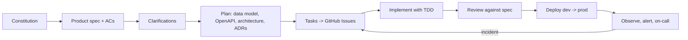

# Development Process

SessionBoard is built with **spec-driven development (SDD)** executed by a team of AI agents
(see `docs/agents/team.md`) under a human owner. GitHub Issues is the shared state between agents.

## 1. SDD flow



| Step | Artifact | Owner | Approval |
|---|---|---|---|
| Constitution | `specs/constitution.md` | Spec agent | Human |
| Specify | `specs/product-spec.md` | Spec agent | Human ("spec approved") |
| Clarify | `## Clarifications` in the spec | Spec agent | Human for open items |
| Plan | `specs/data-model.md`, `specs/api/openapi.yaml`, `docs/architecture.md`, `docs/adr/` | Architect agent | Reviewer agent |
| Tasks | `specs/tasks.md` + GitHub Issues | Architect agent | Human |
| Implement | code + tests, one PR per issue | Backend / Frontend / QA / DevOps agents | Reviewer agent + CI |
| Release | dev automatically, prod manually | DevOps agent | Human approves `production` |

Rule: when implementation reveals a spec gap, stop, update the spec in the same PR (or a preceding one), and mention it in the PR description.

## 2. Issues

- Created from `.github/ISSUE_TEMPLATE/task.yml`. Title `[Txx] <imperative summary>`.
- Required fields: Summary, Spec reference, Acceptance criteria (checkboxes with AC IDs), Test plan, Agent role, Out of scope.
- Labels: one `agent:*`, one `type:*`, one `phase:*`.
- The working agent comments:
  - on start: `[<role>-agent] Starting. Plan: <3-5 bullets>. Branch: <name>`
  - on finish: `[<role>-agent] Done. PR #<n>. Evidence: <gate command output summary>`
  - on block: `[<role>-agent] Blocked: <reason>. Need: <decision>`

## 3. Branches and commits

- Branch: `feat/<issue>-<slug>`, `test/<issue>-<slug>`, `ci/<issue>-<slug>`, `docs/<issue>-<slug>`, `fix/<issue>-<slug>`, `oncall/incident-<issue>`, `drill/<slug>`.
- Conventional Commits: `feat:`, `fix:`, `test:`, `docs:`, `ci:`, `chore:`, `refactor:`.
- Every commit body ends with trailers:
  ```
  Agent: backend-agent
  Refs: #12
  ```
- TDD commits are welcome: `test: add failing AC-2.3 room conflict test` then `feat: detect room conflicts`.

## 4. Pull requests

- One PR per issue, body from `.github/pull_request_template.md`, containing `Closes #<n>`.
- Template sections: Summary · Linked issue · Acceptance criteria checklist (copied from the issue) · Tests added · Spec/contract changes · Screenshots (UI) · Gate output.
- Reviewer agent posts a review using the checklist in `.agents/roles/reviewer.md`; blocking findings → "Request changes".
- Merge strategy: squash. Human merges (except on-call PRs, which auto-merge after CI).

## 5. Environments and releases

`main` is always deployable. Merge to `main` → automatic deploy to **dev**. Promotion to **prod** is a
manual `deploy-prod.yml` run with the dev-verified commit SHA and owner approval. Rollback is `rollback.yml`
with a previous SHA. Details: `docs/deployment.md`.

## 6. Definition of Done

- Issue comments (start, done) present.
- Tests written first and green: `make test`. Lint clean: `make lint`. Hygiene: `python scripts/check_repo_hygiene.py`.
- Spec and contract updated first if behavior or API changed.
- PR reviewed, CI green, `Closes #N`.
- Affected docs updated.
