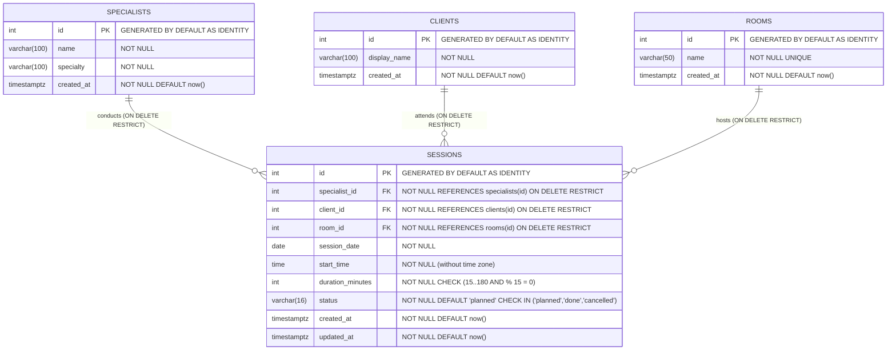

# SessionBoard — Data Model Specification

> **Status:** Approved v1 (Phase 2)
> **Database:** PostgreSQL 16 (`SQLAlchemy 2.x` sync ORM + `psycopg 3`, managed solely via Alembic migrations)

---

## 1. Entity-Relationship Diagram



---

## 2. Table Definitions & Constraints

### 2.1 `specialists`
| Column | Type | Null | Default | Constraints / Notes |
|---|---|---|---|---|
| `id` | `INTEGER` | `NOT NULL` | `Identity` | Primary Key |
| `name` | `VARCHAR(100)` | `NOT NULL` | — | Trimmed non-empty string (`BR-9`) |
| `specialty` | `VARCHAR(100)` | `NOT NULL` | — | Trimmed non-empty string (`BR-9`) |
| `created_at` | `TIMESTAMPTZ` | `NOT NULL` | `now()` | Server default `func.now()` |

### 2.2 `clients`
| Column | Type | Null | Default | Constraints / Notes |
|---|---|---|---|---|
| `id` | `INTEGER` | `NOT NULL` | `Identity` | Primary Key |
| `display_name` | `VARCHAR(100)` | `NOT NULL` | — | Trimmed non-empty string (`BR-9`) |
| `created_at` | `TIMESTAMPTZ` | `NOT NULL` | `now()` | Server default `func.now()` |

### 2.3 `rooms`
| Column | Type | Null | Default | Constraints / Notes |
|---|---|---|---|---|
| `id` | `INTEGER` | `NOT NULL` | `Identity` | Primary Key |
| `name` | `VARCHAR(50)` | `NOT NULL` | — | `UNIQUE` constraint `uq_rooms_name` (`BR-7`), trimmed non-empty (`BR-9`) |
| `created_at` | `TIMESTAMPTZ` | `NOT NULL` | `now()` | Server default `func.now()` |

### 2.4 `sessions`
| Column | Type | Null | Default | Constraints / Notes |
|---|---|---|---|---|
| `id` | `INTEGER` | `NOT NULL` | `Identity` | Primary Key |
| `specialist_id` | `INTEGER` | `NOT NULL` | — | `FOREIGN KEY REFERENCES specialists(id) ON DELETE RESTRICT` |
| `client_id` | `INTEGER` | `NOT NULL` | — | `FOREIGN KEY REFERENCES clients(id) ON DELETE RESTRICT` |
| `room_id` | `INTEGER` | `NOT NULL` | — | `FOREIGN KEY REFERENCES rooms(id) ON DELETE RESTRICT` |
| `session_date` | `DATE` | `NOT NULL` | — | Local studio date (`YYYY-MM-DD`) |
| `start_time` | `TIME` | `NOT NULL` | — | Local studio time (`HH:MM:00`), minutes in `{0, 15, 30, 45}` (`BR-2`) |
| `duration_minutes` | `INTEGER` | `NOT NULL` | — | `CHECK (duration_minutes BETWEEN 15 AND 180 AND duration_minutes % 15 = 0)` (`ck_sessions_duration`) |
| `status` | `VARCHAR(16)` | `NOT NULL` | `'planned'` | `CHECK (status IN ('planned', 'done', 'cancelled'))` (`ck_sessions_status`) |
| `created_at` | `TIMESTAMPTZ` | `NOT NULL` | `now()` | Server default `func.now()` |
| `updated_at` | `TIMESTAMPTZ` | `NOT NULL` | `now()` | Server default `func.now()`, updated on `PATCH` |

---

## 3. Indexes & Concurrency Primitives

### 3.1 Indexes on `sessions`
1. `ix_sessions_date_room` on `(session_date, room_id)` — accelerates Day Board lookup and room conflict queries.
2. `ix_sessions_date_specialist` on `(session_date, specialist_id)` — accelerates specialist conflict queries.
3. `ix_sessions_date_client` on `(session_date, client_id)` — accelerates client conflict queries.

### 3.2 Date-Scoped Advisory Lock (`BR-8`)
Inside the `POST /api/sessions` transaction, before querying existing sessions on `session_date`, the backend executes:
```sql
SELECT pg_advisory_xact_lock(hashtext(CAST(:date_str AS text)));
```
where `:date_str` is `session_date.isoformat()` (e.g. `'2026-12-01'`). This serializes concurrent booking attempts for the same date without locking unrelated dates and automatically releases when the transaction commits or rolls back.

---

## 4. Synthetic Seed Dataset (`backend/app/seed.py`)

Executed on container startup only when `SEED_DEMO_DATA=true` and all four tables are empty:
- **Specialists:** `Alex Morgan` (`Math tutor`), `Sam Lee` (`Guitar coach`), `Jordan Park` (`Speech coach`).
- **Rooms:** `Room A`, `Room B`, `Room C`.
- **Clients:** `Client 01` through `Client 08`.
- **Sessions:** 6 non-overlapping sessions on `date.today()` (`09:00`, `10:00`, `11:00`, `14:00`, `15:00`, `16:00`) across `Room A`, `Room B`, `Room C`.
